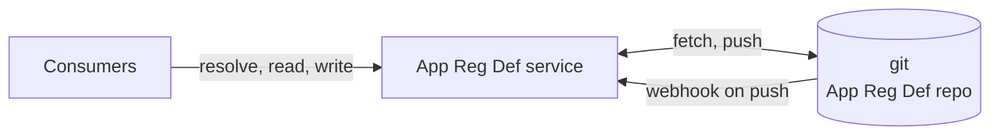
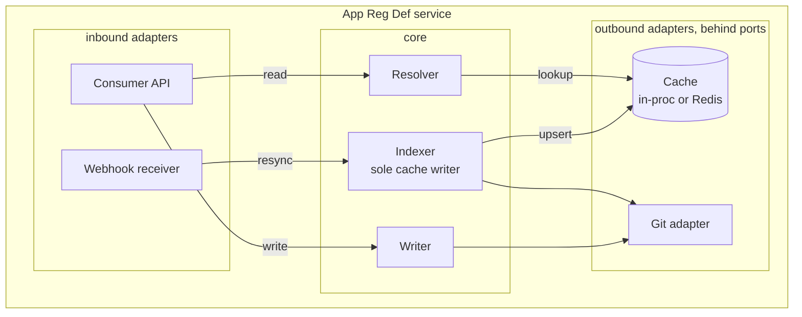
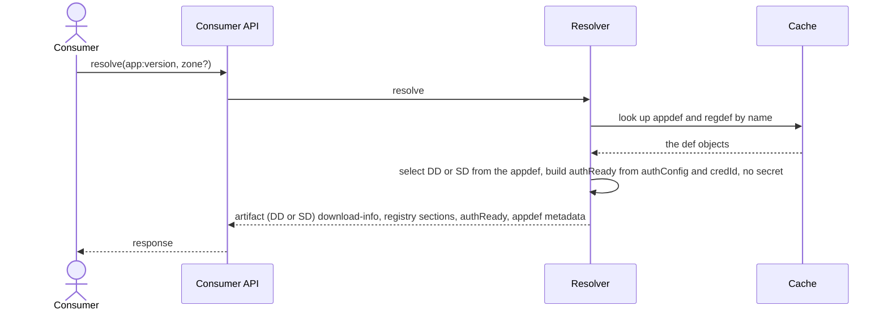
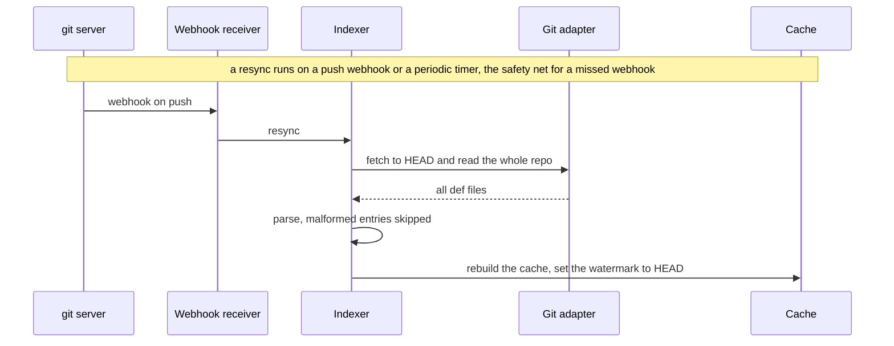
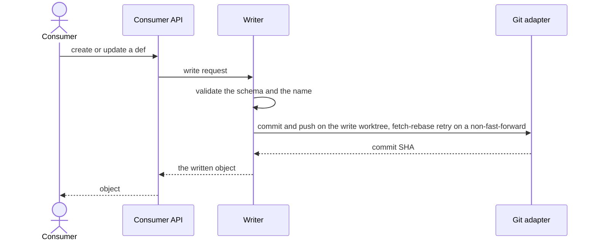

# Architecture

The service's components and its read, resync, and write flows. For the rest, see
[api-reference.md](api-reference.md) for the API contract,
[data-model-and-layout.md](data-model-and-layout.md) for the data model and repository layout,
[consistency-and-sync.md](consistency-and-sync.md) for the consistency rules, and
[deployment-and-operations.md](deployment-and-operations.md) for the operational detail.

## System overview

The service is a runtime resolver and cache over a git source of truth, the dedicated defs repo.It turns
`application:version` into the DD or SD download-info plus all registry sections and the appdef metadata,
auth-ready.

It is blind on credentials: it returns the `authConfig` and the credId references, and the consumer mints
the secret with its own identity.

## Components

One deployable, laid out as ports and adapters, so the calls below are in-process rather than network
hops.

Inbound adapters accept outside traffic, the core holds the logic, and outbound adapters sit behind
ports, as grouped in the diagram.

The Git adapter works two separate worktrees, a read worktree the Indexer resyncs and a write worktree
the Writer commits on, so the resync and write paths do not race on one checkout.

The Indexer is the single writer of the cache, the invariant that keeps reads correct

| Module           | Responsibility                                                                                   |
|------------------|--------------------------------------------------------------------------------------------------|
| Consumer API     | exposes the REST surface, validates requests, authorizes, routes to the Resolver or the Writer   |
| Webhook receiver | validates the git HMAC and triggers a resync                                                     |
| Resolver         | selects DD or SD from the appdef, assembles the resolve response, builds authReady (blind)       |
| Cache            | holds the def objects by name and the watermark, the last resynced commit                        |
| Indexer          | sole cache writer, resyncs the whole repo to HEAD on a webhook or a timer and rebuilds the cache |
| Writer           | create and update, validates the schema and the name, commits and pushes to git                  |
| Git adapter      | clone, fetch, commit, and push on the read and the write worktrees                               |

## Data flows

### Read

### Resync

### Write

A write returns once the commit is pushed. The cache catches up through the resync the push triggers, so
reads are eventually consistent with a write.

## Logical topology

The same modules run in two profiles. The split that matters at the logical level is the read plane
(Consumer API and Resolver over the Cache) versus the write and resync plane (Webhook receiver, Indexer,
Writer). In the lite profile both planes share one process. In the HA profile the read plane scales as
stateless replicas and the write and resync plane runs as one leader. The replica counts, the leader
election, the shared store, and the multi-cluster deployment are in
[deployment-and-operations.md](deployment-and-operations.md).

## Dependency direction

Dependencies point inward through ports, and the graph is acyclic: the Resolver reaches only the Cache,
and only the Indexer and the Writer reach git, each through the Git adapter. The Cache is warmed in full at
bootstrap and is authoritative, so a resolve miss is a not-found, never a git fallback on the read path.
This is what lets the cache move from in-process to Redis and the write and resync plane move to a separate
process without touching the read path.
