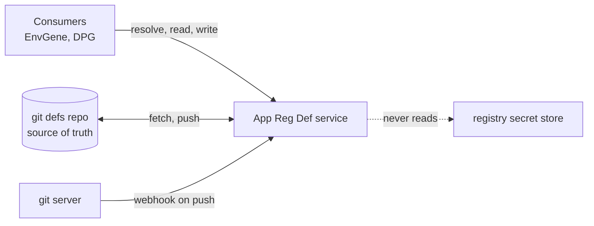
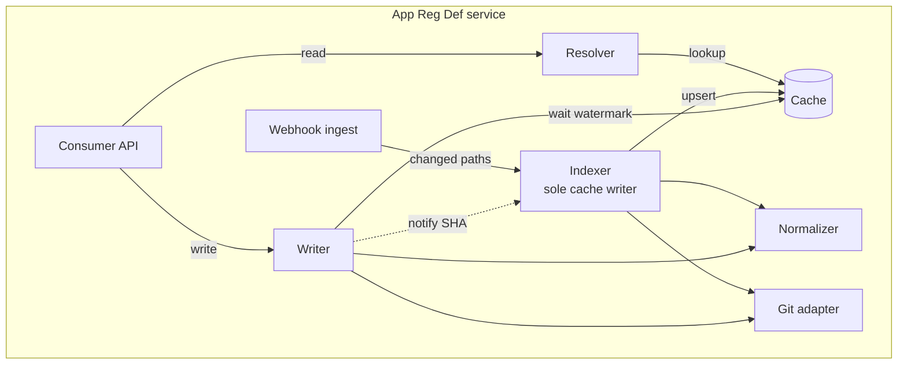
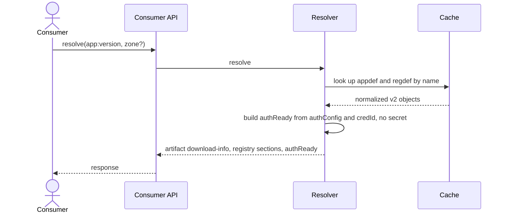
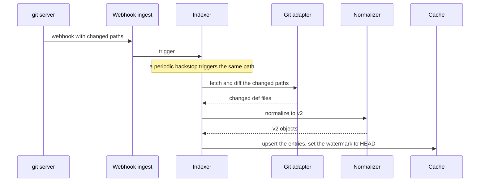
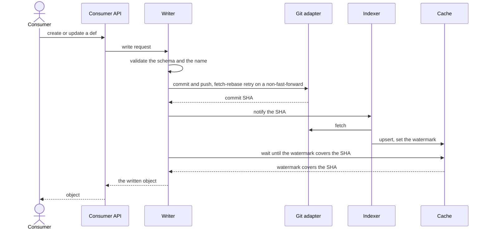

# Architecture

The internal wiring of the service for a developer: its components, how the read, sync, and write flows run
through them, and the logical topology. The API contract is in [api-reference.md](api-reference.md), the
detailed consistency rules are in [consistency-and-sync.md](consistency-and-sync.md), and the operational
detail is in [deployment-and-operations.md](deployment-and-operations.md).

Diagrams are Mermaid, so they live in the doc, render on GitHub, and diff with the text.

## System overview

The service is a runtime resolver and cache over a git source of truth, the dedicated defs repo (its
layout and naming are in [data-model-and-layout.md](data-model-and-layout.md)). It turns
`application:version` into artifact download-info plus all registry sections, normalized to RegDef v2 and
auth-ready. It is blind on credentials: it returns the `authConfig` and the credId references, and the
consumer mints the secret with its own identity. The service never reads a registry secret.

The git webhook enters a distinct Webhook ingest component, not the consumer API (D26, see Components).

## Components

Six runtime components and two shared modules, the Normalizer and the Git adapter. The Indexer is the
single writer of the cache, the invariant that keeps reads correct (see consistency-and-sync).

| Component      | Responsibility                                                                                 | Depends on                     |
|----------------|------------------------------------------------------------------------------------------------|--------------------------------|
| Consumer API   | exposes the REST surface, validates requests, authorizes, routes to the Resolver or the Writer | Resolver, Writer               |
| Webhook ingest | validates the git HMAC and passes the changed paths to the Indexer                             | Indexer                        |
| Resolver       | assembles the resolve response from cached objects, builds authReady (blind)                   | Cache                          |
| Cache          | holds the normalized v2 def objects by name plus the watermark                                 | -                              |
| Indexer        | the sole cache writer, syncs git and updates the cache, incremental and idempotent             | Git adapter, Normalizer, Cache |
| Writer         | create and update, validates, commits and pushes, notifies the Indexer                         | Git adapter, Normalizer, Cache |
| Normalizer     | projects a v1 def to the v2 object                                                             | -                              |
| Git adapter    | clone, fetch, commit, push, and the changed-path diff over the working copies                  | -                              |

## Data flows

### Read

### Sync

### Write

## Logical topology

The same components run in two profiles. The split that matters at the logical level is the read plane
(Consumer API and Resolver over the Cache) versus the write and sync plane (Webhook ingest, Indexer,
Writer). In the lite profile both planes share one process. In the HA profile the read plane scales as
stateless replicas and the write and sync plane runs as one leader. The replica counts, the leader
election, the shared store, and the multi-cluster deployment are in
[deployment-and-operations.md](deployment-and-operations.md).

## Dependency direction

The domain is the Resolver and the Normalizer. They depend on the Cache and the Git adapter as ports, not
on git, HTTP, or the store implementation. This is what lets the cache move from in-process to Redis and
the write and sync plane move to a separate process without touching the read path.
