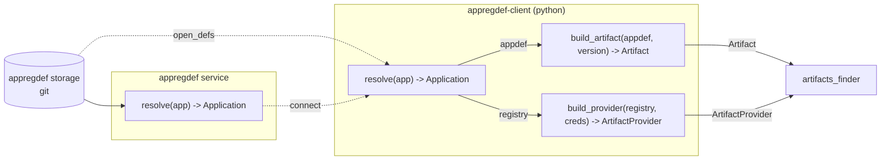

# appregdef-client - interface specification

- [appregdef-client - interface specification](#appregdef-client---interface-specification)
  - [Overview and scope](#overview-and-scope)
  - [Concepts and data contracts](#concepts-and-data-contracts)
  - [Operations](#operations)

This specifies the `appregdef-client` library at the contract level. The object shapes are in
[data-model-and-layout.md](../model.md) and the schemas under `/schemas`.

## Overview and scope

The three layers that turn an application into a downloaded artifact, and how the appregdef service and
the appregdef-client share them.

The library resolves an application to its registry definition and artifact coordinates from a dedicated
defs git repo, and maps a RegDef v2 to a provider of the artifacts_finder common library
(`qubership_pipelines_common_library.v2.artifacts_finder`). The library is the defs-specific layer. It
does not search for or download artifacts. That is artifacts_finder.

It does:

- fetch the defs repo by git, a shallow and sparse checkout of the def folders.
- parse the AppDef and RegDef v2 objects.
- join an AppDef to its RegDef by `registryName`.
- map a RegDef v2 to a configured artifacts_finder provider, and an AppDef and version to an
  artifacts_finder artifact.
- create and update defs, validating them and committing to git.

It does not:

- probe registry tiers, resolve snapshots, execute the registry auth, or download artifacts. The library
  returns the provider and the artifact, and the consumer runs artifacts_finder with them.
- run as a long-lived service, hold a shared cache, or need high availability. Freshness is the consumer's
  git fetch.
- hold or persist secrets. It passes the consumer's credentials into the provider it builds, nothing is
  stored.
- migrate v1 defs to v2. That stays a separate one-time CLI.

The handoff is: `resolve` returns an `Application`, `build_artifact` and `build_provider` turn it, with
the version and the credentials, into an `Artifact` and an `ArtifactProvider`, and the consumer runs
artifacts_finder (`find_artifact_urls` then `download_artifact`) with them. The tier probing, the snapshot
resolution, the auth, and the download are artifacts_finder's contract.

The consumer supplies git access to the defs repo and the registry credentials for the artifact
registries.

## Concepts and data contracts

TBD

## Operations

TBD
