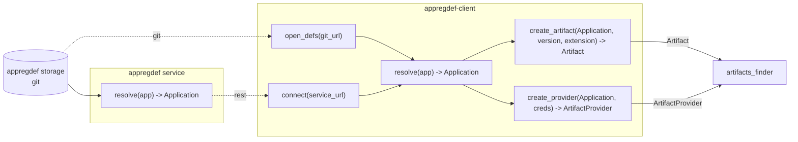

# appregdef-client - interface specification

- [appregdef-client - interface specification](#appregdef-client---interface-specification)
  - [Overview and scope](#overview-and-scope)
  - [Concepts and data contracts](#concepts-and-data-contracts)
  - [Operations](#operations)
    - [Opening a client](#opening-a-client)
      - [open\_defs](#open_defs)
      - [connect](#connect)
    - [Client methods](#client-methods)
      - [resolve](#resolve)
      - [get\_appdef, get\_regdef](#get_appdef-get_regdef)
      - [create\_appdef, create\_regdef, update\_appdef, update\_regdef](#create_appdef-create_regdef-update_appdef-update_regdef)
    - [Functions](#functions)
      - [create\_artifact](#create_artifact)
      - [create\_provider](#create_provider)

This specifies the `appregdef-client` library at the contract level. The object shapes are in
[data-model-and-layout.md](../model.md) and the schemas under `/schemas`.

## Overview and scope

The three layers that turn an application into a downloaded artifact, and how the appregdef service and
the appregdef-client share them.

The library resolves an application to its registry definition and artifact coordinates from a dedicated
defs Git repository, and maps a RegDef v2 to a provider of the artifacts_finder common library
(`qubership_pipelines_common_library.v2.artifacts_finder`). The library is the defs-specific layer. It
does not search for or download artifacts. That is artifacts_finder.

It does:

- fetch the defs repository by Git, a shallow checkout of the whole repository.
- parse the AppDef and RegDef v2 objects.
- join an AppDef to its RegDef by `registryName`.
- map a RegDef v2 to a configured artifacts_finder provider, and an application, a version, and an
  extension to an artifacts_finder artifact.
- create and update defs, validating them and committing to Git.

It does not:

- probe registry tiers, resolve snapshots, execute the registry auth, or download artifacts. The library
  returns the provider and the artifact, and the consumer runs artifacts_finder with them.
- run as a long-lived service, hold a shared cache, or need high availability. Freshness is the consumer's
  `git fetch`.
- hold or persist secrets. It passes the consumer's credentials into the provider it builds, nothing is
  stored.
- migrate v1 defs to v2. That stays a separate one-time CLI.

The handoff is: `resolve` returns an `Application`, `create_artifact` and `create_provider` turn it, with
the version, the extension, and the credentials, into an `Artifact` and an `ArtifactProvider`, and the
consumer runs artifacts_finder (`find_artifact_urls` then `download_artifact`) with them. The tier probing,
the snapshot resolution, the auth, and the download are artifacts_finder's contract.

The consumer supplies Git access to the defs repository and the registry credentials for the artifact
registries.

## Concepts and data contracts

TBD

## Operations

The consumer first opens a `client` with `open_defs` or `connect`, then calls the client's read and write
methods. `create_artifact` and `create_provider` are standalone functions over an `Application`, not client
methods. Each operation below is one line on what it is, then a list of the behavior that matters.

### Opening a client

#### open_defs

`open_defs(git_url, ref="main", git_auth=...) -> client`

Opens the defs over Git and returns the client the consumer then calls.

- it is the Git-backed way to open the defs, `connect` is the service-backed one, and both return the
  same client.
- it makes a shallow clone, depth 1, of the whole tree at `ref`, not sparse. The client takes every
  folder, including `schemas/`, which `resolve` validates against, since the schemas live in the
  repository,
  not in code. The history is not needed, so the clone stays shallow.
- the client is one object. Reads: `resolve`, `get_appdef`, `get_regdef`. Writes: `create_appdef`,
  `create_regdef`, `update_appdef`, `update_regdef`. How a write resolves concurrency is under create
  and update.
- no cache and no background sync. Freshness is the consumer's own re-open or `git fetch`.
- `git_auth` carries the Git credentials for a private repository. Its exact form is left open for now.

#### connect

`connect(service_url, service_auth=...) -> client`

TBD

### Client methods

#### resolve

`resolve(app) -> Application`

Joins an application's two stored definitions into one `Application`.

- it reads the AppDef named `app`, follows its `registryName` to that RegDef, validates both against
  their committed schemas, and returns the `Application`, carrying the full AppDef with the full RegDef
  joined in.
- it fails if the AppDef is absent, or if its `registryName` points at a RegDef that does not exist.

#### get_appdef, get_regdef

`get_appdef(name) -> AppDef`

`get_regdef(name) -> RegDef`

Return one stored definition by its own name, as stored, without the join.

- unlike `resolve`, which joins into an `Application`, these return the raw AppDef or RegDef, each
  validated against its committed schema.
- they are mostly for editing a def, read one with `get`, change it, then write it back with `update`.
- to get the RegDef an application uses, call `resolve`, not `get_regdef`. `resolve` returns that RegDef
  joined in, while `get_regdef` needs the registry's own name.
- a missing name is an error, not an empty result, the same for `get_appdef` and `get_regdef`.

#### create_appdef, create_regdef, update_appdef, update_regdef

`create_appdef(appdef) -> AppDef`, `create_regdef(regdef) -> RegDef`

`update_appdef(appdef) -> AppDef`, `update_regdef(regdef) -> RegDef`

Write one definition. `create_*` adds a new one, `update_*` replaces an existing one with the full def
given.

- there are four methods, one per operation and collection, matching the read split: the `*_appdef`
  pair over `AppDefs/`, the `*_regdef` pair over `RegDefs/`.
- `update_*` replaces the whole def with the one passed in, it does not merge. The read-modify-write is
  the caller's, `get` the def, change it, and pass the full result back.
- each validates the def against its committed schema before writing, so a malformed def is rejected
  with no commit.
- each returns the stored def, the canonical form now in the repository after validation.
- a write commits and pushes, and on a non-fast-forward it fetches, rebases, and retries up to three
  times. A concurrent change to a different file is absorbed by the rebase, a concurrent change to the
  same file is a conflict, and the write fails.
- `create_*` fails if a def of that name already exists, `update_*` fails if it does not.
- the filename without the extension is the def `name`, so the write targets `AppDefs/<name>.yaml` or
  `RegDefs/<name>.yaml`.

### Functions

#### create_artifact

`create_artifact(Application, version, extension) -> Artifact`

Builds the artifact coordinates of an application's DD or SD at a given version.

- it bundles the coordinates the search needs: `groupId` and `artifactId` from the `Application`, the
  `version` from the caller, and the file `extension` (`zip` or `json`).

#### create_provider

`create_provider(Application, creds) -> ArtifactProvider`

Builds a configured artifacts_finder provider from an application's registry.

- it is backend-free, a pure function over an `Application` and the caller's `creds`, with no store
  access.
- it reads only `Application.registry`, the joined RegDef, its repository URLs and names, and never the
  AppDef side, so it stays a registry concern though it takes the whole `Application`.
- `creds` is the `REGISTRY_CREDENTIALS` payload the caller supplies, never read from the store, keeping
  the capability blind. How a `credId` in the RegDef maps into it is TBD.
- which lifecycle tiers (snapshot, staging, release, group) are tried, and in what order, is
  artifacts_finder's responsibility, decided by the artifact version, not a parameter here.
