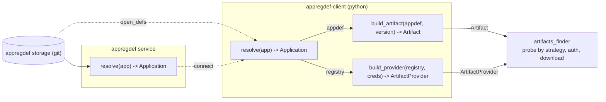

# Resolver contract

The three layers that turn an application into a downloaded artifact, and how the service and the library
share them. The object shapes are in [model.md](model.md). This is the high-level picture, the detailed
function contracts follow later.

