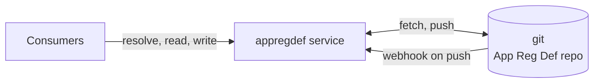
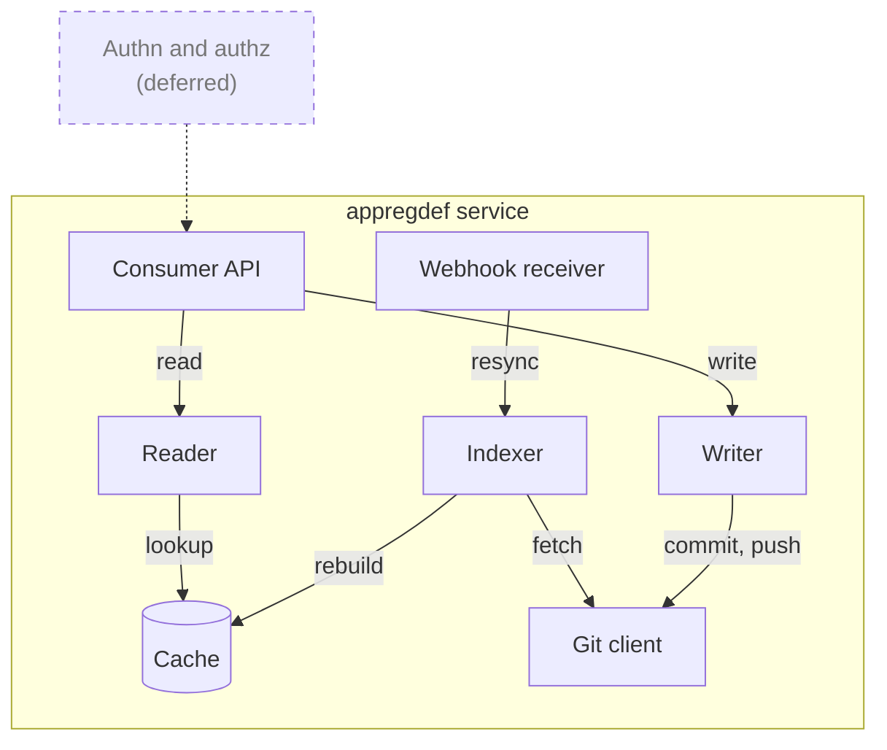
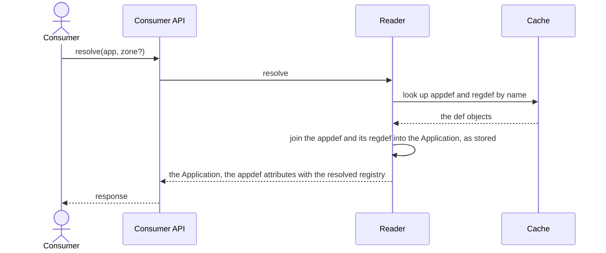
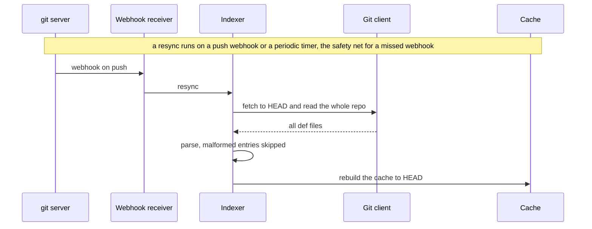
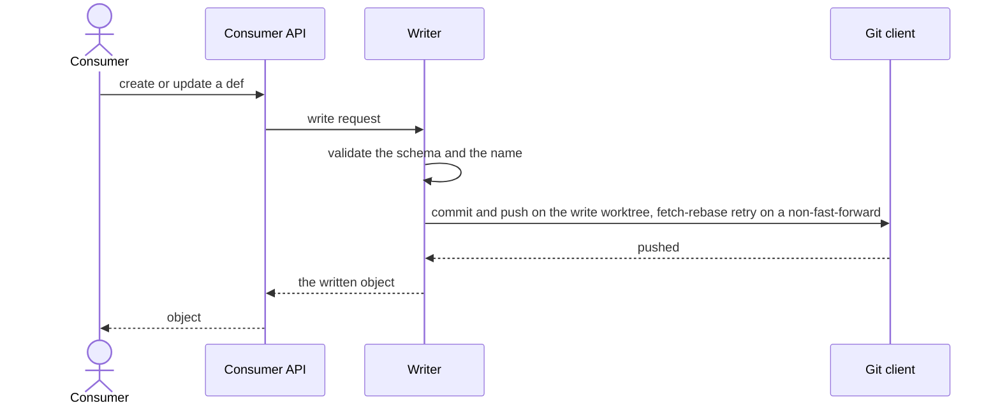

# Architecture

The service's components and its read, resync, and write flows. For the rest, see
[api-reference.md](api-reference.md) for the API contract,
[data-model-and-layout.md](../model.md) for the data model and repository layout,
[consistency-and-sync.md](consistency-and-sync.md) for the consistency rules, and
[deployment-and-operations.md](deployment-and-operations.md) for the operational detail.

## Scope

In scope now is the single-process service: resolve, the read and write interfaces, and the git sync, with
an in-process cache. High availability and horizontal scale-out, running several replicas behind a shared
cache and across clusters, are deferred, and so are authorization and multizone, with one zone today. The
design stays open to them: the cache can move to a shared store later. The rest of this page describes the
single-process service.

## System overview

The service is a runtime resolver and cache over a git source of truth, the dedicated defs repo. It
resolves an application to its `Application`, the AppDef attributes with its RegDef joined in as
`registry`.

It returns the RegDef with its `credId` references, not the secret values, and it never contacts a
registry. The consumer adds the version and the credentials to build the artifact and the provider and
download through the client and artifacts_finder.

## Components

One deployable with a small set of components. The calls between them are in-process.

| Component        | Responsibility                                                                              |
|------------------|---------------------------------------------------------------------------------------------|
| Consumer API     | exposes the API, validates requests, calls the Reader or the Writer                         |
| Webhook receiver | receives the git push notification and triggers a resync                                    |
| Reader           | returns a RegDef or AppDef by name, and for resolve joins them into the Application         |
| Cache            | holds the def objects by name, an in-process map now, swappable to a shared store later     |
| Indexer          | cache writer, resyncs the whole repo to HEAD on a webhook or a timer and rebuilds the cache |
| Writer           | create and update, validates then commits and pushes the def                                |
| Git client       | clone, fetch, commit, and push on the read and the write                                    |

## Data flows

### Read

`getRegDef` and `getAppDef` are the same cache read without the join: the Reader returns the stored RegDef
or AppDef by name.

### Resync

### Write

A write returns once the commit is pushed. The cache catches up through the resync the push triggers, so
reads are eventually consistent with a write.
