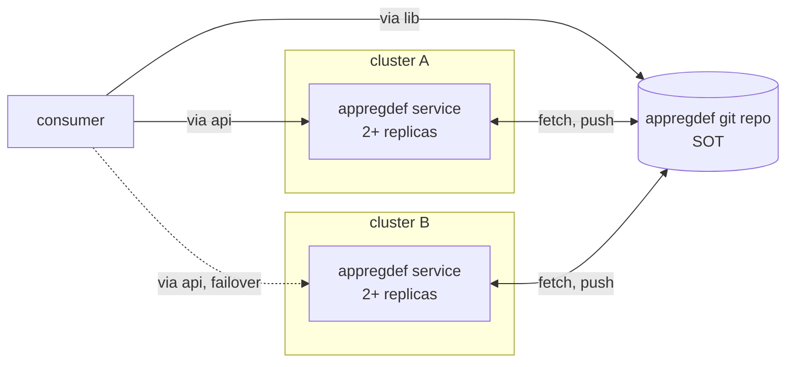
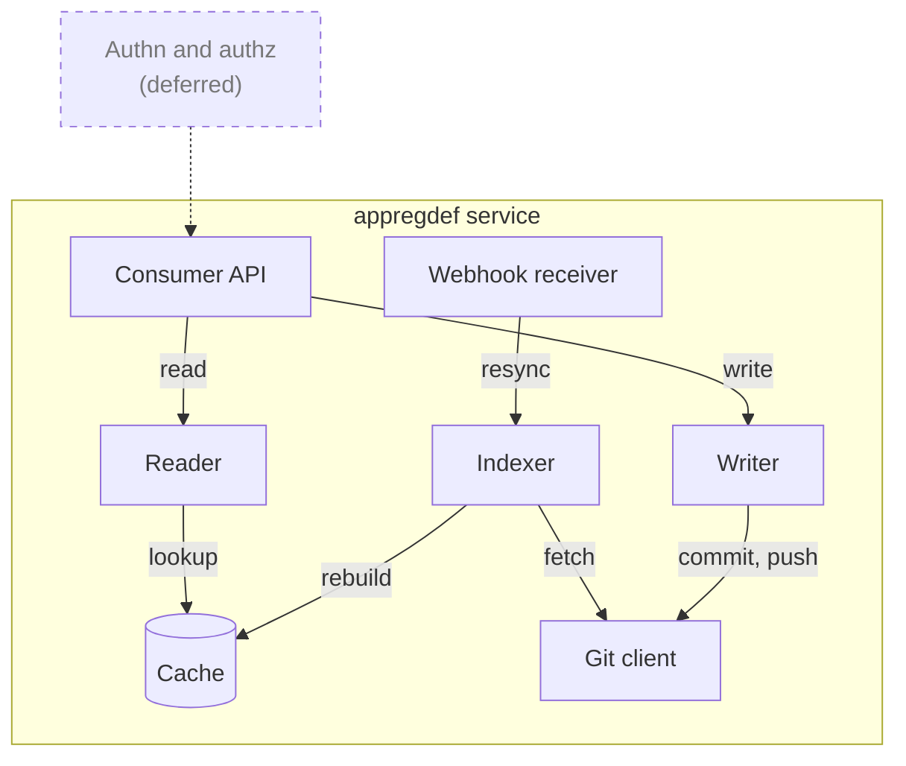
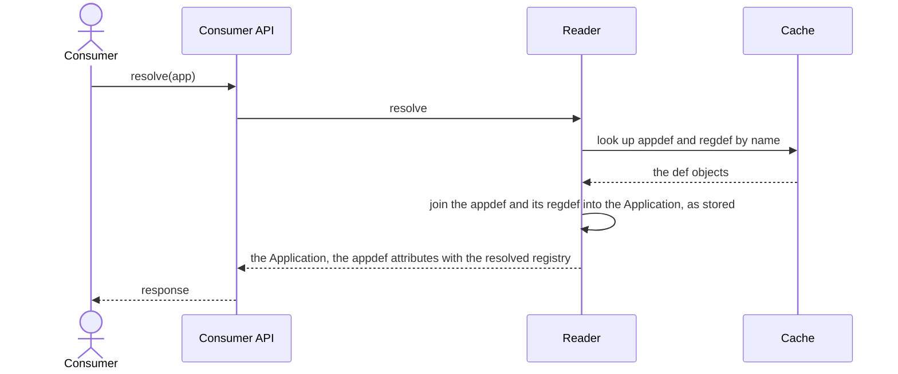
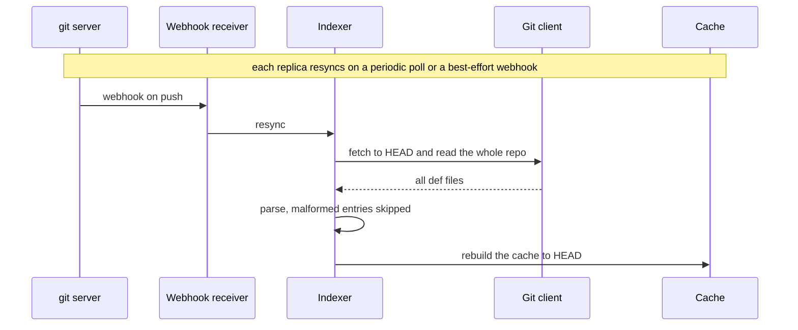
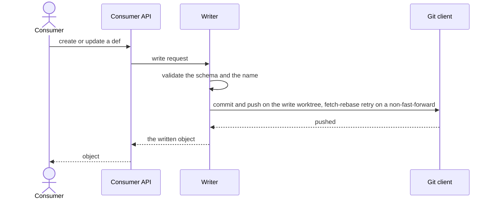

# Architecture

The service's components and its read, resync, and write flows. For the rest, see
[api-reference.md](api-reference.md) for the API contract,
[data-model-and-layout.md](../model.md) for the data model and repository layout,
[consistency-and-sync.md](consistency-and-sync.md) for the consistency rules, and
[deployment-and-operations.md](deployment-and-operations.md) for the operational detail.

## Limitations

- Authorization (authn and authz) is deferred.
- Multizone is deferred, with one zone today.

## Overview

The service is a runtime resolver and cache over a git source of truth, the dedicated defs repo. It
resolves an application to its `Application`, the AppDef attributes with its RegDef joined in as
`registry`.

It returns the RegDef with its `credId` references, not the secret values, and it never contacts a
registry. The consumer adds the version and the credentials to build the artifact and the provider and
download through the client and artifacts_finder.

## Components

Each replica runs the same set of components, so the diagram shows one replica. The calls between
components are in-process.

| Component        | Responsibility                                                                              |
|------------------|---------------------------------------------------------------------------------------------|
| Consumer API     | exposes the API, validates requests, calls the Reader or the Writer                         |
| Webhook receiver | receives the git push notification and triggers a resync                                    |
| Reader           | returns a RegDef or AppDef by name, and for resolve joins them into the Application         |
| Cache            | holds the def objects by name, an in-memory map now, swappable to a shared store later      |
| Indexer          | cache writer, resyncs the whole repo to HEAD on a webhook or a timer and rebuilds the cache |
| Writer           | create and update, validates then commits and pushes the def                                |
| Git client       | clone, fetch, commit, and push on the read and the write                                    |

## Topology

The replicas run in more than one cluster over the one shared git. Each replica is independent, with its
own in-memory cache and nothing shared:

- a replica loss leaves the others serving.
- git unreachable keeps reads serving from the in-memory cache, only writes block.
- any replica can write, and git serializes concurrent writers, so the replicas need no coordinator.

Freshness is a periodic git poll per replica. A git push webhook is a best-effort speed-up, it reaches one
replica and freshens only that one, so the poll is what brings the rest up to date. Replicas can briefly
sit at different commits, within one poll interval, an eventual consistency the deploy tolerates.

Reaching the defs, two paths:

- via the library: a consumer embeds the client library and reads git directly, so it does not depend on
  the service. The library is a Python package, so Python consumers embed it, for example EnvGene and DPG.
- via the API: a consumer calls the HTTP service, for consumers that cannot embed the library, other
  languages or ones that should not hold git access.

On the API path, a consumer outside the reaches it through a stable internal name whose redundancy and
failover are handled on the network and DNS side, not by the consumer, since the consumers are many and not
all retry.

## Data flows

### Read

`getRegDef` and `getAppDef` are the same cache read without the join: the Reader returns the stored RegDef
or AppDef by name.

### Resync

### Write

A write returns once the commit is pushed. The cache catches up through the resync the push triggers, so
reads are eventually consistent with a write.
