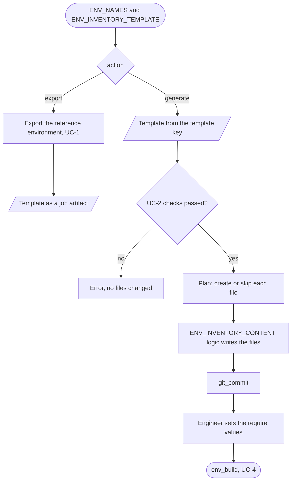

# Inventory template and environment generation (v2)

> [!NOTE]
> Design draft (HLD), version 2. Names marked "working name" are not final.

## Purpose and scope

Goal: create an Inventory template from a reference environment, and create a new environment from that template. The
new environment can be in the same Instance repository or in another one.

The **Inventory Template** component has two operations on one template model:

- **export** creates a template from a reference environment.
- **generate** creates a new environment from a template.

The two operations run separately. The export operation saves the template as a job artifact. The generate operation
takes the template as input. How the template is delivered to another site is an open question.

Limits:

- Only No-CMDB environments (v1 and v2) are supported.
- Only the creation of a new environment is supported. Updating an existing environment from a template is out of scope.
- Existing repository files are never changed. This includes shared files on the `cluster` and `site` levels.
- One run handles one environment.
- The template has no Jinja parameters. Comments from reference files are not copied.

## Overview



| Part               | Instance pipeline step                      | Status   | What it does                                                                           |
|--------------------|---------------------------------------------|----------|----------------------------------------------------------------------------------------|
| export             | `env_inventory_export` (working name)       | new      | Reads the reference, applies transfer rules, outputs the template                      |
| generate: planner  | new, runs before `env_inventory_generation` | new      | Checks the template and the repository, decides create or skip per file, builds a plan |
| generate: executor | `env_inventory_generation`                  | extended | Executes the plan in the `ENV_INVENTORY_CONTENT` format                                |
| build check        | `env_build`                                 | extended | Stops the build if `env_definition.yml` contains `envgeneNullValue`                    |

The planner does not write files. The executor makes no decisions. The existing `ENV_INVENTORY_CONTENT` contract stays
the only way to write Inventory files.

## Pipeline parameters

The name of the new parameter is a working name.

| Parameter                | Mandatory | Value                                                                                        |
|--------------------------|-----------|----------------------------------------------------------------------------------------------|
| `ENV_NAMES`              | yes       | Exactly one `<cluster>/<env>`. For export, the reference. For generate, the new environment. |
| `ENV_INVENTORY_TEMPLATE` | yes       | JSON with the action and, for generate, the template                                         |

Values of `ENV_INVENTORY_TEMPLATE`:

```json
{ "action": "export" }
```

```json
{ "action": "generate", "template": { "apiVersion": "v1", "kind": "InventoryTemplate", "spec": {} } }
```

| Key        | When       | Value                                                           |
|------------|------------|-----------------------------------------------------------------|
| `action`   | always     | `export` creates a template. `generate` creates an environment. |
| `template` | `generate` | The content of a template created earlier by export             |

The parameter is validated against a schema before any step runs. A failed check stops the run:

- `action` is mandatory and is `export` or `generate`.
- For `generate`, `template` is mandatory. For `export`, `template` is not allowed.
- `ENV_INVENTORY_TEMPLATE` cannot be combined with `ENV_INVENTORY_CONTENT`, `ENV_BUILDER`, or `GENERATE_EFFECTIVE_SET`.

A new way to pass the template, for example a reference to an artifact, is added as a new key next to `template`. The
generate logic does not change.

## Export operation

### UC-1. Create a template

```text
Actor:          owner of the reference environment
Trigger:        ENV_INVENTORY_TEMPLATE with action: export
Preconditions:
  - environments/<cluster>/<env>/Inventory/env_definition.yml of the reference exists.
  - The reference is a No-CMDB environment (inventory.deployer is not set).
Main flow:
  1. Reads env_definition.yml and collects file names from envTemplate:
     envSpecific*Paramsets, sharedMasterCredentialFiles, sharedTemplateVariables,
     and envSpecificResourceProfiles. Removes duplicates.
  2. Finds each file:
     - In the repository (env, then cluster, then site): the file is copied to the template.
       The level where the file was found is written to place.
     - In the Environment Template of the reference (paramsets only): only the reference
       is copied. The name is added to fromEnvironmentTemplate.
  3. Selects a transfer rule for each value: for env_definition objects from the object
     table, for files by file type.
  4. Writes the values to the template according to the rule.
  5. Saves the template as a job artifact.
Exceptions (no template is created):
  E1. inventory.deployer is set.
  E2. A referenced file is not in the repository and not in the Environment Template.
      The message lists all missing files.
  E3. A YAML file of the reference is not valid.
Result:
  A template. The repository does not change. No commit.
```

### Transfer rules

| Rule      | In the template        | In the new environment                           |
|-----------|------------------------|--------------------------------------------------|
| `keep`    | Value of the reference | The same value                                   |
| `require` | `envgeneNullValue`     | `envgeneNullValue`. The engineer sets the value. |
| `exclude` | No key                 | No key                                           |
| `ref`     | List of file names     | The same list. Each file follows its own rule.   |

The rules are built into the component. A rules configuration is not added until analysis of real repositories shows
that it is needed.

#### env_definition objects

The object list follows `schemas/env-definition.schema.json`.

| Object                                                                                                                                                                      | Rule                     | Reason                                                                     |
|-----------------------------------------------------------------------------------------------------------------------------------------------------------------------------|--------------------------|----------------------------------------------------------------------------|
| `inventory.environmentName`                                                                                                                                                 | `exclude`                | The name comes from the environment folder                                 |
| `inventory.tenantName`                                                                                                                                                      | `require`                | Each environment has its own tenant                                        |
| `inventory.cloudName`, `inventory.cloudPassport`                                                                                                                            | `require`                | The new environment can be on another cluster                              |
| `inventory.clusterUrl`                                                                                                                                                      | `require`                | Each cluster has its own URL                                               |
| `inventory.deployer`                                                                                                                                                        | -                        | If set, no template is created (E1)                                        |
| `inventory.noCmdbVersion`                                                                                                                                                   | `keep`                   | If not set, v1 is used. A v2 reference switches the new environment to v2. |
| `inventory.description`, `inventory.owners`                                                                                                                                 | `exclude`                | They describe the reference                                                |
| `inventory.config.*`                                                                                                                                                        | `keep`                   | The flags are the same for all environments of the model                   |
| `envTemplate.name`                                                                                                                                                          | `keep`                   | One Environment Template                                                   |
| `envTemplate.artifact`, `envTemplate.templateArtifact.artifact.version`                                                                                                     | `require`                | The version is set per environment                                         |
| `envTemplate.templateArtifact`: `registry`, `repository`, `templateRepository`, `artifact.group_id`, `artifact.artifact_id`                                                 | `keep`                   | The artifact coordinates are the same                                      |
| `envTemplate.bgNsArtifacts.origin`, `envTemplate.bgNsArtifacts.peer`                                                                                                        | `require`                | Blue-Green versions are set per environment                                |
| `envTemplate.additionalTemplateVariables`                                                                                                                                   | `require` for each value | The variables have no contract                                             |
| `envSpecificParamsets`, `envSpecificTechnicalParamsets`, `envSpecificE2EParamsets`, `sharedTemplateVariables`, `sharedMasterCredentialFiles`, `envSpecificResourceProfiles` | `ref`                    | Lists of file names                                                        |
| `metadata`, `security`                                                                                                                                                      | `exclude`                | Not set by hand, per the schema                                            |
| `generatedVersions`                                                                                                                                                         | `exclude`                | Written by EnvGene                                                         |

#### Files referenced from env_definition

The rule applies to the whole file and depends on the file type.

| File                      | Rule                                                                | Reason                                                                                           |
|---------------------------|---------------------------------------------------------------------|--------------------------------------------------------------------------------------------------|
| Paramset                  | `keep`                                                              | All env-specific parameters of the reference are copied. The engineer removes extra ones in Git. |
| Shared template variables | `keep`                                                              | Same format as a paramset                                                                        |
| Credentials               | `require` for each value. `id`, `type`, and field names are copied. | Values are secret and differ per environment                                                     |
| Resource profiles         | `keep`                                                              | Profiles are the same for all environments of the model                                          |

Keep static shared paramsets, such as e2e ones, in the Environment Template. Use Cloud Passport macros for values that
depend on the cluster. The Inventory template then does not need to copy them.

## Template

The template is a `kind: InventoryTemplate` document. The `spec` blocks are the same as in `ENV_INVENTORY_CONTENT`
(`envDefinition`, `paramSets`, `credentials`, `resourceProfiles`, and `sharedTemplateVariables`), but without `action`.
The planner selects the action.

```yaml
apiVersion: v1
kind: InventoryTemplate
metadata:
  name: ref-env
  source: ref-cluster/ref-env@<commit>
  generatedAt: "2026-11-25T10:00:00Z"
spec:
  envDefinition:
    content:
      inventory:
        tenantName: envgeneNullValue
        noCmdbVersion: v2
      envTemplate:
        name: bss-template
        artifact: envgeneNullValue
        envSpecificParamsets:
          bss:
            - bss-db
            - bss-tuning
        envSpecificE2EParamsets:
          bss:
            - bss-e2e
  paramSets:
    - name: bss-db
      place: cluster
      content:
        parameters:
          DB_POOL: 50
    - name: bss-tuning
      place: env
      content:
        parameters:
          replicas: 2
  fromEnvironmentTemplate:
    - bss-e2e
```

| Field                     | Value                                                                     |
|---------------------------|---------------------------------------------------------------------------|
| `apiVersion`              | Version of the template format, `v1`                                      |
| `metadata.name`           | Name of the template                                                      |
| `metadata.source`         | Reference environment and commit                                          |
| `metadata.generatedAt`    | Creation time                                                             |
| Entry `name`              | File name, as in the `env_definition` reference                           |
| Entry `place`             | File level in the reference: `env`, `cluster`, or `site`                  |
| Entry `content`           | File content after the transfer rules                                     |
| `fromEnvironmentTemplate` | Names of paramsets that the reference takes from the Environment Template |

## Generate operation

### UC-2. Create an environment from a template

```text
Actor:          engineer who creates the environment
Trigger:        ENV_INVENTORY_TEMPLATE with action: generate
Preconditions:
  - The global configuration of the repository exists.
Main flow:
  1. Takes the template from the template key.
  2. The planner runs these checks before any file changes:
     - The template matches the schema.
     - The environment <cluster>/<env> does not exist.
     - Each file referenced in env_definition is in the template, in the repository,
       or in fromEnvironmentTemplate.
     - No file with the same name exists only on another level.
  3. The planner decides for each entry:
     - The file does not exist on the place level: create it.
     - The file exists (a shared cluster or site file): skip it. The warning lists the
       keys and credential IDs from the template that the existing file does not have.
  4. Builds the plan: ENV_INVENTORY_CONTENT with the create action for each file to create.
     Skipped files are not in the plan.
  5. Calls the ENV_INVENTORY_CONTENT logic (env_inventory_generation). It writes the files
     of the plan.
  6. git_commit. The log lists the envgeneNullValue keys and the skipped files.
Exceptions (steps 1-2, no files change):
  E1. The template does not match the schema.
  E2. The environment already exists.
  E3. A referenced file is not in the template, the repository, or fromEnvironmentTemplate.
  E4. A file with the same name exists only on another level.
Result:
  A new environment. Existing repository files are not changed.
```

A file is created on its `place` level, as in the reference. The paths follow the "Paths by place" table in
`docs/features/env-inventory-generation.md`. A parameter on the environment or namespace level stays on that level.

The Environment Template version of the new environment uses the `require` rule. `envTemplate.artifact` stays
`envgeneNullValue` until the engineer sets it. Because of this, generate does not check the paramsets in
`fromEnvironmentTemplate`. `env_build` checks that they exist in the Environment Template.

### Changes to env_inventory_generation

- New `create` action in all `ENV_INVENTORY_CONTENT` blocks (`envDefinition`, `paramSets`, `credentials`,
  `resourceProfiles`, and `sharedTemplateVariables`). It creates the file. If a file already exists at the target path,
  the validation fails and no file changes. `content` is mandatory, as for `create_or_replace`. The planner decides what
  to create. The executor makes sure that an existing file is never overwritten. `create_or_replace` and `delete` work
  as before.
- The step accepts the plan from the planner as an internal input. The size limit of a pipeline parameter does not apply
  to the plan.
- `sharedTemplateVariables` files are written to `configurations/`, as the documentation says. The code currently writes
  them to `shared_template_variables/`, which is not in the search paths.

Existing calls with `ENV_INVENTORY_CONTENT` work without changes.

### Examples

"Target repository before generate" is the state of the repository where the new environment is created, before generate
runs. "`ENV_INVENTORY_CONTENT` action" is what the planner passes to the executor.

| #  | Case                                   | Reference environment                    | Target repository before generate      | Planner decision                            | `ENV_INVENTORY_CONTENT` action                    | Generated environment                                                         |
|----|----------------------------------------|------------------------------------------|----------------------------------------|---------------------------------------------|---------------------------------------------------|-------------------------------------------------------------------------------|
|    | **Values**                             |                                          |                                        |                                             |                                                   |                                                                               |
| 1  | `keep` value                           | `replicas: 2`                            | No environment                         | Create with the reference value             | `paramSets[]: create`                             | `replicas: 2`                                                                 |
| 2  | `require` value                        | `tenantName: tenant-ref`                 | No environment                         | Create, the engineer sets the value         | `envDefinition: create`                           | `tenantName: envgeneNullValue`. The build fails until it is set (UC-4).       |
| 3  | `exclude` key                          | `environmentName: ref-env`               | No environment                         | Key not in the template (decided by export) | `envDefinition: create`                           | No key. The name comes from the folder.                                       |
| 4  | Parameter used only by the reference   | `debugMode: true`                        | No environment                         | Create as in the reference                  | `paramSets[]: create`                             | `debugMode: true`. The engineer removes it in Git if not needed.              |
| 5  | Credentials                            | `dbPassword: <secret>`                   | No environment                         | Create without secrets                      | `credentials[]: create`                           | `dbPassword: envgeneNullValue`. `id`, `type`, and fields as in the reference. |
|    | **Files and levels**                   |                                          |                                        |                                             |                                                   |                                                                               |
| 6  | Environment-level paramset             | `bss-tuning`, place `env`                | No environment                         | Create                                      | `paramSets[]: create`, `place: env`               | Created in the new environment folder                                         |
| 7  | Cluster-level paramset, no file        | `bss-db`, place `cluster`, `DB_POOL: 50` | No file                                | Create on the same level                    | `paramSets[]: create`, `place: cluster`           | Created in the cluster folder, `DB_POOL: 50`                                  |
| 8  | Cluster-level paramset, file exists    | `bss-db`, place `cluster`, `DB_POOL: 50` | `bss-db`, `DB_POOL: 10`                | Do not change, warn                         | Not in the plan                                   | No change, `DB_POOL: 10`, warning in the log                                  |
| 9  | Same file name only on another level   | `bss-db`, place `cluster`                | `bss-db` in `environments/parameters/` | Error E4                                    | No plan                                           | No files changed                                                              |
| 10 | List of references                     | `bss: [bss-db, bss-tuning]`              | No environment                         | Copy the list                               | `envDefinition: create`                           | `bss: [bss-db, bss-tuning]`                                                   |
| 11 | Paramset from the Environment Template | `bss-e2e` in `fromEnvironmentTemplate`   | -                                      | Reference only, no check                    | Not in the plan                                   | Reference in `env_definition`. `env_build` checks it.                         |
|    | **Environment**                        |                                          |                                        |                                             |                                                   |                                                                               |
| 12 | No environment                         | -                                        | No folder                              | Create all files                            | `create` for each file                            | All files created, one commit                                                 |
| 13 | Environment exists                     | -                                        | `env_definition.yml` exists            | Error E2                                    | No plan. `envDefinition: create` would also fail. | No files changed                                                              |
| 14 | Environment Template version           | `artifact: app:1.0`                      | No environment                         | Create, the engineer sets the version       | `envDefinition: create`                           | `artifact: envgeneNullValue`                                                  |

## Build check

### UC-4. Block the build of an environment with unset values

```text
Actor:          env_build and generate_effective_set steps
Trigger:        environment build (ENV_BUILDER=true, GENERATE_EFFECTIVE_SET=true)
Current behavior:
  generate_effective_set and cmdb_import fail if envgeneNullValue remains in parameters
  or credentials. env_definition fields are not checked: the environment is built with
  the tenant "envgeneNullValue".
New behavior:
  1. env_build checks env_definition.yml for envgeneNullValue.
  2. If values are found, the step fails and lists the fields.
  3. The parameter and credential check in generate_effective_set does not change.
```

## Open questions

- How is the template delivered to another site?
- Are creating a template and bringing the reference to best practice one operation or two?
- Should files from deprecated folders be included in the template?
- Is a separate report needed (found files, values to set, skipped files), or is the job log enough?
- Should the new environment store a record of the reference and the template it was created from? Without it, a correct
  update cannot be built later.

## Future work

- Parameter descriptions: where to take them from (paramsets, credentials) and how to write them above the keys. Version
  1 has no descriptions. Unset values are visible as `envgeneNullValue`, and UC-4 stops the build without them.
- Updating an environment that was created from a template.

## Non-functional requirements

| ID    | Attribute                | Condition                                  | Acceptance criterion                                                               |
|-------|--------------------------|--------------------------------------------|------------------------------------------------------------------------------------|
| NFR-1 | Repeated run             | generate for an existing environment       | No files changed, no commit (E2)                                                   |
| NFR-2 | Atomicity                | Any UC-2 check fails                       | No file changed                                                                    |
| NFR-3 | Security                 | export                                     | No credential values in the template or the log. No SOPS key needed.               |
| NFR-4 | Data safety              | generate in a repository with shared files | Existing `cluster` and `site` files not changed                                    |
| NFR-5 | Backward compatibility   | Existing `ENV_INVENTORY_CONTENT` calls     | `env_inventory_generation` regression tests pass without changes                   |
| NFR-6 | GitLab and GitHub parity | Run in both CI systems                     | Same template and Inventory. `ENV_INVENTORY_TEMPLATE` fits the GitHub input limit. |
| NFR-7 | Readable changes         | Commit after generate                      | One commit with all created files                                                  |
