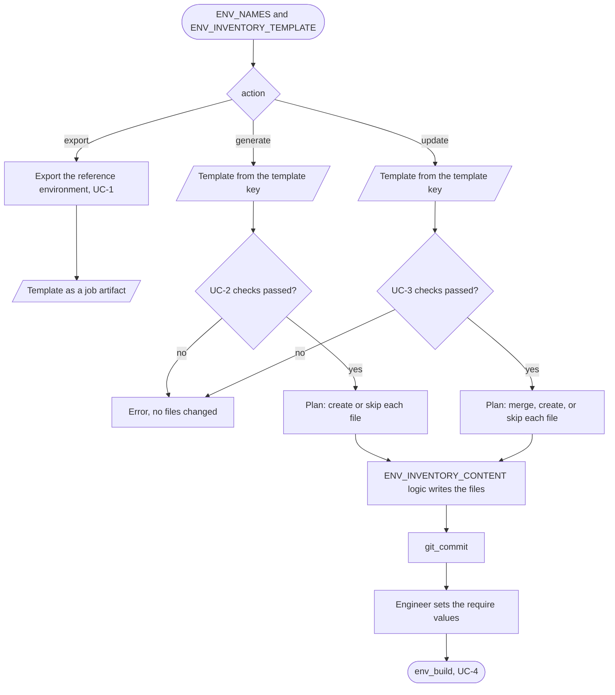

# Inventory template and environment generation (v2)

> [!NOTE]
> Design draft (HLD), version 2. Names marked "working name" are not final.

## Purpose and scope

Goal: create an Inventory template from a reference environment, and create or update an environment from that template.
The environment can be in the same Instance repository or in another one.

The **Inventory Template** component has three operations on one template model:

- **export** creates a template from a reference environment (UC-1).
- **generate** creates a new environment from a template (UC-2).
- **update** updates an environment created earlier from a new template (UC-3).

The operations run separately. The export operation saves the template as a job artifact. The generate and update
operations take the template as input. How the template is delivered to another site is an open question.

Limits:

- Only No-CMDB environments (v1 and v2) are supported.
- The generate operation only creates files. It never changes existing files.
- The update operation changes only `env` level files of the target environment. No operation changes shared files on
  the `cluster` and `site` levels. A warning is written to the log instead.
- Files are never deleted. If a file is removed from the template, only its reference in `env_definition.yml` is
  removed.
- One run handles one environment.
- The template has no Jinja parameters. Comments from reference files are not copied.

## Overview



| Part                        | Instance pipeline step                      | Status   | What it does                                                                                                                                           |
|-----------------------------|---------------------------------------------|----------|--------------------------------------------------------------------------------------------------------------------------------------------------------|
| export                      | `env_inventory_export` (working name)       | new      | Reads the reference, applies transfer rules, outputs the template                                                                                      |
| generate / update: planner  | new, runs before `env_inventory_generation` | new      | Checks the template and the repository, decides `create`, `merge` (update only), or skip per file, builds a plan in the `ENV_INVENTORY_CONTENT` format |
| generate / update: executor | `env_inventory_generation`                  | extended | Executes the plan in the `ENV_INVENTORY_CONTENT` format                                                                                                |
| build check                 | `env_build`                                 | extended | Stops the build if `env_definition.yml` contains `envgeneNullValue`                                                                                    |

The planner does not write files. The executor makes no decisions. The existing `ENV_INVENTORY_CONTENT` contract stays
the only way to write Inventory files.

## Pipeline parameters

The name of the new parameter is a working name.

| Parameter                | Mandatory | Value                                                                                                                              |
|--------------------------|-----------|------------------------------------------------------------------------------------------------------------------------------------|
| `ENV_NAMES`              | yes       | Exactly one `<cluster>/<env>`. For export, the reference. For generate, the new environment. For update, the existing environment. |
| `ENV_INVENTORY_TEMPLATE` | yes       | JSON with the action and, for generate and update, the template                                                                    |

Values of `ENV_INVENTORY_TEMPLATE`:

```json
{ "action": "export" }
```

```json
{ "action": "generate", "template": { "apiVersion": "v1", "kind": "InventoryTemplate", "spec": {} } }
```

```json
{ "action": "update", "template": { "apiVersion": "v1", "kind": "InventoryTemplate", "spec": {} } }
```

| Key        | When                 | Value                                                                                                                |
|------------|----------------------|----------------------------------------------------------------------------------------------------------------------|
| `action`   | always               | `export` creates a template. `generate` creates an environment. `update` updates an environment (3-way merge, UC-3). |
| `template` | `generate`, `update` | The content of a template created earlier by export                                                                  |

The parameter is validated against a schema before any step runs. A failed check stops the run:

- `action` is mandatory and is `export`, `generate`, or `update`.
- For `generate` and `update`, `template` is mandatory. For `export`, `template` is not allowed.
- `ENV_INVENTORY_TEMPLATE` cannot be combined with `ENV_INVENTORY_CONTENT`, `ENV_BUILDER`, or `GENERATE_EFFECTIVE_SET`.

A new way to pass the template, for example a reference to an artifact, is added as a new key next to `template`. The
generate logic does not change.

## Export operation

### UC-1. Create a template

```text
Actor:          owner of the reference environment
Trigger:        ENV_INVENTORY_TEMPLATE with action: export
Preconditions:
  - environments/<cluster>/<env>/Inventory/env_definition.yml of the reference exists.
  - The reference is a No-CMDB environment (inventory.deployer is not set).
Main flow:
  1. Reads env_definition.yml and collects file names from envTemplate:
     envSpecific*Paramsets, sharedMasterCredentialFiles, sharedTemplateVariables,
     and envSpecificResourceProfiles. Removes duplicates.
  2. Finds each file:
     - In the repository (env, then cluster, then site): the file is copied to the template.
       The level where the file was found is written to place.
     - In the Environment Template of the reference (paramsets only): only the reference
       is copied. The name is added to fromEnvironmentTemplate.
  3. Selects a transfer rule for each value:
     - env_definition objects: from the built-in object table.
     - Referenced files: from the explicit rule (option 1 or option 2).
     - No rule set: require (the value becomes envgeneNullValue).
  4. Writes the values to the template according to the rule.
  5. Saves the template as a job artifact.
Exceptions (no template is created):
  E1. inventory.deployer is set.
  E2. A referenced file is not in the repository and not in the Environment Template.
      The message lists all missing files.
  E3. A YAML file of the reference is not valid.
  E4. A credential value has the keep rule. The secret would be copied to the
      template (NFR-3). The message lists the credential ID and the field.
Result:
  A template. The repository does not change. No commit.
```

> [!IMPORTANT]
> Default: if no rule is set for a value, the `require` rule applies. The template gets `envgeneNullValue`, and the
> engineer sets the value. A value of the reference is copied as is only with an explicit `keep` rule. Explicit rules
> for files are set with option 1 or option 2 (see [Transfer rules](#transfer-rules)). The rules for `env_definition`
> objects are built in.

### Transfer rules

| Rule      | In the template        | In the new environment                           |
|-----------|------------------------|--------------------------------------------------|
| `keep`    | Value of the reference | The same value                                   |
| `require` | `envgeneNullValue`     | `envgeneNullValue`. The engineer sets the value. |
| `exclude` | No key                 | No key                                           |
| `ref`     | List of file names     | The same list. Each file follows its own rule.   |

The rules for `env_definition` are built into the component (see the table below). For paramsets, shared template
variables, resource profiles, and credentials, the component does not know what the parameters mean. Their rules are set
in one of two ways.

#### Transfer rules for referenced files

##### Option 1: rules in the template

The template author sets a rule for each paramset in the `InventoryTemplate`. Rules for single keys are optional.

```yaml
kind: InventoryTemplate
spec:
  envSpecificParamsets:
    - name: bss-db
      rule: keep              # all keys are copied as is
    - name: global-ci-creds
      rule: require           # default: all keys become envgeneNullValue
      keys:
        CI_USER: keep         # override for one key
        WEBEX_TOKEN: exclude  # this key is not copied
```

If `keys` is not set, `rule` applies to all keys. If `rule` is not set, the default is `require` (values become
`envgeneNullValue`). A rule in `keys` overrides the `rule` of the paramset.

Flow:

- export: the component reads the reference and creates the template. For paramsets without a rule, it writes `rule:
  require` and `envgeneNullValue` instead of the values.
- The template author edits the template: sets `rule: keep` where the reference values must be copied, adds `keys` for
  exceptions, and runs export again. If nothing is changed, all values in the new environment are `envgeneNullValue`.
- generate and update: the component reads the rules from the template, builds the `ENV_INVENTORY_CONTENT` plan, and
  creates or updates the environment.

Limit: a paramset added to the reference after the template was created is not in the template. Export must run again.

##### Option 2: rules in the JSON Schema of the paramset

The paramset owner describes each key with `x-transfer` in a JSON Schema and stores the schema in Git or another source.
The component reads the schema during export, generate, and update. The template has no rules.

```json
{
  "properties": {
    "CI_USER":     { "type": "string", "x-transfer": "keep" },
    "WEBEX_TOKEN": { "type": "string", "x-transfer": "exclude", "x-site-specific": true },
    "CI_TOKEN":    { "type": "string", "x-transfer": "require" }
  }
}
```

Flow:

- The paramset owner writes the JSON Schema once and stores it in Git or another source.
- export: the component reads the schema, derives the rules, and creates the template.
- generate and update: the component reads the schema again (or takes the rules from the template) and creates or
  updates the environment.

Open question: where the schemas are stored and how they are delivered to another site with the template.

#### env_definition objects

The object list follows `schemas/env-definition.schema.json`.

| Object                                                                                                                                                                      | Rule                     | Reason                                                                     |
|-----------------------------------------------------------------------------------------------------------------------------------------------------------------------------|--------------------------|----------------------------------------------------------------------------|
| `inventory.environmentName`                                                                                                                                                 | `exclude`                | The name comes from the environment folder                                 |
| `inventory.tenantName`                                                                                                                                                      | `require`                | Each environment has its own tenant                                        |
| `inventory.cloudName`, `inventory.cloudPassport`                                                                                                                            | `require`                | The new environment can be on another cluster                              |
| `inventory.clusterUrl`                                                                                                                                                      | `require`                | Each cluster has its own URL                                               |
| `inventory.deployer`                                                                                                                                                        | -                        | If set, no template is created (E1)                                        |
| `inventory.noCmdbVersion`                                                                                                                                                   | `keep`                   | If not set, v1 is used. A v2 reference switches the new environment to v2. |
| `inventory.description`, `inventory.owners`                                                                                                                                 | `exclude`                | They describe the reference                                                |
| `inventory.config.*`                                                                                                                                                        | `keep`                   | The flags are the same for all environments of the model                   |
| `envTemplate.name`                                                                                                                                                          | `keep`                   | One Environment Template                                                   |
| `envTemplate.artifact`, `envTemplate.templateArtifact.artifact.version`                                                                                                     | `require`                | The version is set per environment                                         |
| `envTemplate.templateArtifact`: `registry`, `repository`, `templateRepository`, `artifact.group_id`, `artifact.artifact_id`                                                 | `keep`                   | The artifact coordinates are the same                                      |
| `envTemplate.bgNsArtifacts.origin`, `envTemplate.bgNsArtifacts.peer`                                                                                                        | `require`                | Blue-Green versions are set per environment                                |
| `envTemplate.additionalTemplateVariables`                                                                                                                                   | `require` for each value | The variables have no contract                                             |
| `envSpecificParamsets`, `envSpecificTechnicalParamsets`, `envSpecificE2EParamsets`, `sharedTemplateVariables`, `sharedMasterCredentialFiles`, `envSpecificResourceProfiles` | `ref`                    | Lists of file names                                                        |
| `metadata`, `security`                                                                                                                                                      | `exclude`                | Not set by hand, per the schema                                            |
| `generatedVersions`                                                                                                                                                         | `exclude`                | Written by EnvGene                                                         |

#### Files referenced from env_definition

A rule applies to the whole file or to single keys (option 1 or option 2). Without an explicit rule, the default from
the table applies.

| File                      | Default (no rule set)                                               | Allowed explicit rules                            | Reason                                                                                             |
|---------------------------|---------------------------------------------------------------------|---------------------------------------------------|----------------------------------------------------------------------------------------------------|
| Paramset                  | `require` for each value. Key names are copied.                     | `keep`, `require`, `exclude`                      | The component does not know what the parameters mean. A reference value is copied only on request. |
| Shared template variables | `require` for each value                                            | `keep`, `require`, `exclude`                      | Same format as a paramset                                                                          |
| Credentials               | `require` for each value. `id`, `type`, and field names are copied. | `require`, `exclude`. `keep` is not allowed (E4). | Values are secret and differ per environment (NFR-3)                                               |
| Resource profiles         | `require` for each value                                            | `keep`, `require`, `exclude`                      | Profiles that are the same for all environments are copied with an explicit `keep`                 |

Keep static shared paramsets, such as e2e ones, in the Environment Template. Use Cloud Passport macros for values that
depend on the cluster. The Inventory template then does not need to copy them.

## Template

The template is a `kind: InventoryTemplate` document. The `spec` blocks are the same as in `ENV_INVENTORY_CONTENT`
(`envDefinition`, `paramSets`, `credentials`, `resourceProfiles`, and `sharedTemplateVariables`), but without `action`.
The planner selects the action.

```yaml
apiVersion: v1
kind: InventoryTemplate
metadata:
  name: ref-env
  source: ref-cluster/ref-env@<commit>
  generatedAt: "2026-11-25T10:00:00Z"
spec:
  envDefinition:
    content:
      inventory:
        tenantName: envgeneNullValue
        noCmdbVersion: v2
      envTemplate:
        name: bss-template
        artifact: envgeneNullValue
        envSpecificParamsets:
          bss:
            - bss-db
            - bss-tuning
        envSpecificE2EParamsets:
          bss:
            - bss-e2e
  paramSets:
    - name: bss-db
      place: cluster
      content:
        parameters:
          DB_POOL: 50
    - name: bss-tuning
      place: env
      content:
        parameters:
          replicas: 2
  fromEnvironmentTemplate:
    - bss-e2e
```

| Field                     | Value                                                                     |
|---------------------------|---------------------------------------------------------------------------|
| `apiVersion`              | Version of the template format, `v1`                                      |
| `metadata.name`           | Name of the template                                                      |
| `metadata.source`         | Reference environment and commit                                          |
| `metadata.generatedAt`    | Creation time                                                             |
| Entry `name`              | File name, as in the `env_definition` reference                           |
| Entry `place`             | File level in the reference: `env`, `cluster`, or `site`                  |
| Entry `content`           | File content after the transfer rules                                     |
| `fromEnvironmentTemplate` | Names of paramsets that the reference takes from the Environment Template |

## Generate operation

### UC-2. Create an environment from a template

```text
Actor:          engineer who creates the environment
Trigger:        ENV_INVENTORY_TEMPLATE with action: generate
Preconditions:
  - The global configuration of the repository exists.
Main flow:
  1. Takes the template from the template key.
  2. The planner runs these checks before any file changes:
     - The template matches the schema.
     - The environment <cluster>/<env> does not exist.
     - Each file referenced in env_definition is in the template, in the repository,
       or in fromEnvironmentTemplate.
     - No file with the same name exists only on another level.
  3. The planner decides for each entry:
     - The file does not exist on the place level: create it.
     - The file exists (a shared cluster or site file): skip it. The warning lists the
       keys and credential IDs from the template that the existing file does not have.
  4. Builds the plan: ENV_INVENTORY_CONTENT with the create action for each file to create.
     Skipped files are not in the plan.
  5. Calls the ENV_INVENTORY_CONTENT logic (env_inventory_generation). It writes the files
     of the plan.
  6. git_commit. The log lists the envgeneNullValue keys and the skipped files.
Exceptions (steps 1-2, no files change):
  E1. The template does not match the schema.
  E2. The environment already exists.
  E3. A referenced file is not in the template, the repository, or fromEnvironmentTemplate.
  E4. A file with the same name exists only on another level.
Result:
  A new environment. Existing repository files are not changed.
```

The `keep`, `require`, and `exclude` rules work as described in [Transfer rules](#transfer-rules).

A file is created on its `place` level, as in the reference. The paths follow the "Paths by place" table in
`docs/features/env-inventory-generation.md`. A parameter on the environment or namespace level stays on that level.

### Changes to env_inventory_generation

- New `create` action in all `ENV_INVENTORY_CONTENT` blocks (`envDefinition`, `paramSets`, `credentials`,
  `resourceProfiles`, and `sharedTemplateVariables`). It creates the file. If a file already exists at the target path,
  the validation fails and no file changes. `content` is mandatory, as for `create_or_replace`. The planner decides what
  to create. The executor makes sure that an existing file is never overwritten. `create_or_replace` and `delete` work
  as before.
- New `merge` action in the same blocks (for `action: update`, UC-3). It updates an existing file key by key. `content`
  holds the keys to write. `removeKeys` holds the keys to remove. Other keys of the file do not change. If the file does
  not exist, the validation fails. The action is needed because `create_or_replace` overwrites the whole file and would
  erase the `require` values that the engineer set. The format is a working draft (see [Open
  questions](#open-questions)).
- The step accepts the plan from the planner as an internal input. The size limit of a pipeline parameter does not apply
  to the plan.
- `sharedTemplateVariables` files are written to `configurations/`, as the documentation says. The code currently writes
  them to `shared_template_variables/`, which is not in the search paths.

Existing calls with `ENV_INVENTORY_CONTENT` work without changes.

### Examples

"Target repository before generate" is the state of the repository where the new environment is created, before generate
runs. "`ENV_INVENTORY_CONTENT` action" is what the planner passes to the executor.

| #   | Case                                   | Reference environment                    | Target repository before generate      | Planner decision                                        | `ENV_INVENTORY_CONTENT` action                    | Generated environment                                                             |
|-----|----------------------------------------|------------------------------------------|----------------------------------------|---------------------------------------------------------|---------------------------------------------------|-----------------------------------------------------------------------------------|
|     | **Values**                             |                                          |                                        |                                                         |                                                   |                                                                                   |
| 1   | `keep` value                           | `replicas: 2`                            | No environment                         | Create with the reference value                         | `paramSets[]: create`                             | `replicas: 2`                                                                     |
| 2   | `require` value                        | `tenantName: tenant-ref`                 | No environment                         | Create, the engineer sets the value                     | `envDefinition: create`                           | `tenantName: envgeneNullValue`. The build fails until it is set (UC-4).           |
| 3   | `exclude` key                          | `environmentName: ref-env`               | No environment                         | Key not in the template (decided by export)             | `envDefinition: create`                           | No key. The name comes from the folder.                                           |
| 4   | No rule for the key (default)          | `debugMode: true`                        | No environment                         | Create, the engineer sets the value (default `require`) | `paramSets[]: create`                             | `debugMode: envgeneNullValue`. The engineer removes the key in Git if not needed. |
| 5   | Credentials                            | `dbPassword: <secret>`                   | No environment                         | Create without secrets                                  | `credentials[]: create`                           | `dbPassword: envgeneNullValue`. `id`, `type`, and fields as in the reference.     |
|     | **Files and levels**                   |                                          |                                        |                                                         |                                                   |                                                                                   |
| 6   | Environment-level paramset             | `bss-tuning`, place `env`                | No environment                         | Create                                                  | `paramSets[]: create`, `place: env`               | Created in the new environment folder                                             |
| 7   | Cluster-level paramset, no file        | `bss-db`, place `cluster`, `DB_POOL: 50` | No file                                | Create on the same level                                | `paramSets[]: create`, `place: cluster`           | Created in the cluster folder, `DB_POOL: 50`                                      |
| 8   | Cluster-level paramset, file exists    | `bss-db`, place `cluster`, `DB_POOL: 50` | `bss-db`, `DB_POOL: 10`                | Do not change, warn                                     | Not in the plan                                   | No change, `DB_POOL: 10`, warning in the log                                      |
| 9   | Same file name only on another level   | `bss-db`, place `cluster`                | `bss-db` in `environments/parameters/` | Error E4                                                | No plan                                           | No files changed                                                                  |
| 10  | List of references                     | `bss: [bss-db, bss-tuning]`              | No environment                         | Copy the list                                           | `envDefinition: create`                           | `bss: [bss-db, bss-tuning]`                                                       |
| 11  | Paramset from the Environment Template | `bss-e2e` in `fromEnvironmentTemplate`   | -                                      | Reference only, no check                                | Not in the plan                                   | Reference in `env_definition`. `env_build` checks it after the version is set.    |
|     | **Environment**                        |                                          |                                        |                                                         |                                                   |                                                                                   |
| 12  | No environment                         | -                                        | No folder                              | Create all files                                        | `create` for each file                            | All files created, one commit                                                     |
| 13  | Environment exists                     | -                                        | `env_definition.yml` exists            | Error E2                                                | No plan. `envDefinition: create` would also fail. | No files changed                                                                  |
| 14  | Environment Template version           | `artifact: app:1.0`                      | No environment                         | Create, the engineer sets the version                   | `envDefinition: create`                           | `artifact: envgeneNullValue`                                                      |

### UC-3. Update an environment from a template

```text
Actor:          owner of the environment
Trigger:        ENV_INVENTORY_TEMPLATE with action: update (see Open questions)
Preconditions:
  - The environment <cluster>/<env> exists (created by UC-2).
  - The new template was created from the same reference (UC-1).
  - The merge base is available: the template that the environment was created
    or last updated from (how it is stored is an open question).
Main flow:
  1. Takes the new template from the template key.
  2. The planner runs these checks before any file changes:
     - The template matches the schema.
     - The environment <cluster>/<env> exists.
     - The merge base is found.
     - Each file referenced in env_definition is in the template, in the repository,
       or in fromEnvironmentTemplate.
     - No file with the same name exists only on another level.
  3. The planner reads three inputs: the merge base, the new template, and the current
     files of the target environment. The rules come from the new template (option 1)
     or from the JSON Schema (option 2).
  4. The planner decides for each entry of the template:
     - The file does not exist: create it, as in UC-2.
     - An env level file exists: merge it. Each key follows the
       "Rule behavior on update" table.
     - A cluster or site level file exists: skip it. The warning lists the keys
       that differ from the template.
  5. Builds the plan: ENV_INVENTORY_CONTENT with create and merge. A merge entry holds
     only the keys to write (content) and to remove (removeKeys). Unchanged keys are
     not in the plan.
  6. Calls env_inventory_generation. It executes the plan.
  7. git_commit. The log lists the changed, added, and removed keys, the new
     envgeneNullValue keys, the skipped files, and the conflicts.
  8. The new template becomes the merge base for the next update.
Exceptions (steps 1-2, no files change):
  E1. The template does not match the schema.
  E2. The environment does not exist. Use generate.
  E3. The merge base is not found.
  E4. A referenced file is not in the template, the repository, or fromEnvironmentTemplate.
  E5. A file with the same name exists only on another level.
Conflict (not an error):
  A keep key was changed both in the reference and by the engineer in the target
  environment. The reference value is written. The old and the new values are written
  to the log (for credentials, only the key name).
Result:
  The env level files are updated in one commit. Shared files are not changed.
  New require keys are envgeneNullValue and block the build (UC-4).
  If the template did not change against the merge base, the plan is empty and there
  is no commit.
```

#### Rule behavior on update

| Rule                       | Key in the merge base and in the new template                                                                      | New key (not in the merge base)    | Key removed from the template (in the merge base)                            | Key only in the target environment (added by the engineer) |
|----------------------------|--------------------------------------------------------------------------------------------------------------------|------------------------------------|------------------------------------------------------------------------------|------------------------------------------------------------|
| `keep`                     | The template value changed: write it (if the engineer also changed it, log a conflict). Not changed: do not touch. | Add the template value             | Remove                                                                       | Do not touch                                               |
| `require`                  | Do not touch, the engineer set the value                                                                           | Add `envgeneNullValue`             | Remove. If a value was set, log the key name.                                | Do not touch                                               |
| `exclude`                  | Do not touch                                                                                                       | Do not add                         | Do not touch                                                                 | Do not touch                                               |
| `ref` (list of file names) | The name stays                                                                                                     | Add the name. The file is created. | Remove the name from the list. The file is not deleted, a warning is logged. | The name stays                                             |

On update, `exclude` means "do not touch". This keeps `inventory.description` and `inventory.owners`, which the engineer
set, and `generatedVersions`, which EnvGene writes.

The merge base tells a key removed from the reference from a key added by the engineer, and a change in the reference
from a change by the engineer. Without the merge base, both cases look the same.

#### Example

The environment was created from a template (the merge base). The engineer set the `require` values and changed some
keys. Then the reference changed, and a new template was created from it. Paramset `bss-tuning` is on the `env` level
with `rule: keep`. Paramset `bss-db` is on the `cluster` level.

| #   | Key                                | Rule           | Merge base             | New template                      | Target environment before update  | Target environment after update                                       |
|-----|------------------------------------|----------------|------------------------|-----------------------------------|-----------------------------------|-----------------------------------------------------------------------|
| 1   | `envTemplate.artifact`             | `require`      | `envgeneNullValue`     | `envgeneNullValue`                | `bss-template:1.4.0`              | `bss-template:1.4.0`. The engineer raises the version.                |
| 2   | `inventory.tenantName`             | `require`      | `envgeneNullValue`     | `envgeneNullValue`                | `tenant-stage`                    | `tenant-stage`                                                        |
| 3   | `inventory.description`            | `exclude`      | -                      | -                                 | `Stage BSS`                       | `Stage BSS`                                                           |
| 4   | `bss-tuning.replicas`              | `keep`         | `2`                    | `3`                               | `2`                               | `3`                                                                   |
| 5   | `bss-tuning.timeout`               | `keep`         | `30`                   | `30`                              | `60` (changed by the engineer)    | `60`. The reference did not change.                                   |
| 6   | `bss-tuning.poolSize`              | `keep`         | `10`                   | `20`                              | `15` (changed by the engineer)    | `20`, conflict in the log                                             |
| 7   | `bss-tuning.cpuLimit`              | `keep`, new    | -                      | `2`                               | -                                 | `2`                                                                   |
| 8   | `bss-tuning.apiToken`              | `require`, new | -                      | `envgeneNullValue`                | -                                 | `envgeneNullValue`. The build is blocked (UC-4).                      |
| 9   | `bss-tuning.debugMode`             | `keep`         | `true`                 | - (removed from the reference)    | `true`                            | Removed                                                               |
| 10  | `bss-tuning.localFlag`             | -              | -                      | -                                 | `true` (added by the engineer)    | `true`                                                                |
| 11  | `bss-db.DB_POOL` (`cluster` level) | `keep`         | `50`                   | `60`                              | `10`                              | `10`. The shared file is not changed, warning in the log.             |
| 12  | `envSpecificParamsets.bss`         | `ref`          | `[bss-db, bss-tuning]` | `[bss-db, bss-tuning, bss-cache]` | `[bss-db, bss-tuning, bss-local]` | `[bss-db, bss-tuning, bss-local, bss-cache]`. `bss-cache` is created. |

The plan holds rows 4, 6, 7, 8, and 12 (`merge` with `content`), row 9 (`merge` with `removeKeys`), and `bss-cache`
(`create`). Rows 1-3, 5, 10, and 11 are not in the plan.

## Build check

### UC-4. Block the build of an environment with unset values

```text
Actor:          env_build and generate_effective_set steps
Trigger:        environment build (ENV_BUILDER=true, GENERATE_EFFECTIVE_SET=true)
Current behavior:
  generate_effective_set and cmdb_import fail if envgeneNullValue remains in parameters
  or credentials. env_definition fields are not checked: the environment is built with
  the tenant "envgeneNullValue".
New behavior:
  1. env_build checks env_definition.yml for envgeneNullValue.
  2. If values are found, the step fails and lists the fields.
  3. The parameter and credential check in generate_effective_set does not change.
```

## Open questions

- How is the template delivered to another site?
- Are creating a template and bringing the reference to best practice one operation or two?
- Should files from deprecated folders be included in the template?
- Is a separate report needed (found files, values to set, skipped files, update conflicts), or is the job log enough?
- **Merge base** (blocks UC-3): where is the template that the environment was created or last updated from stored?
  Options: a copy of the template in the environment folder (written by generate and update); a record of the reference
  and the commit in `env_definition.yml`, with a repeated export from that commit; Git history. A copy also works for
  another repository and another site. Without the merge base, update cannot tell a change in the reference from a
  change by the engineer.
- **`action: update` or `action: generate`** (blocks the UC-3 trigger): a separate `action: update` (now in the pipeline
  parameters), or generate selects the behavior by whether the environment exists? A separate action keeps the E2
  protection in UC-2: generate never changes an existing environment by mistake. In both cases, `ENV_INVENTORY_CONTENT`
  gets the `merge` action, because `create_or_replace` would erase the `require` values that the engineer set. The
  `merge` format (`content` and `removeKeys`) must be approved.
- **`keep` conflict on update**: does the reference win (as in UC-3 now), or does update stop and list the conflicts?

## Future work

- Parameter descriptions: where to take them from (paramsets, credentials) and how to write them above the keys. Version
  1 has no descriptions. Unset values are visible as `envgeneNullValue`, and UC-4 stops the build without them.

## Non-functional requirements

| ID    | Attribute                | Condition                                            | Acceptance criterion                                                               |
|-------|--------------------------|------------------------------------------------------|------------------------------------------------------------------------------------|
| NFR-1 | Repeated run             | generate for an existing environment                 | No files changed, no commit (E2)                                                   |
| NFR-2 | Atomicity                | Any UC-2 or UC-3 check fails                         | No file changed                                                                    |
| NFR-3 | Security                 | export, update                                       | No credential values in the template or the log. No SOPS key needed for export.    |
| NFR-4 | Data safety              | generate or update in a repository with shared files | Existing `cluster` and `site` files not changed                                    |
| NFR-5 | Backward compatibility   | Existing `ENV_INVENTORY_CONTENT` calls               | `env_inventory_generation` regression tests pass without changes                   |
| NFR-6 | GitLab and GitHub parity | Run in both CI systems                               | Same template and Inventory. `ENV_INVENTORY_TEMPLATE` fits the GitHub input limit. |
| NFR-7 | Readable changes         | Commit after generate or update                      | One commit with all changed files                                                  |
| NFR-8 | Idempotent update        | Repeated update with the same template               | Empty plan, no files changed, no commit                                            |
| NFR-9 | Engineer data safety     | update                                               | `require` values, `exclude` keys, and keys added by the engineer are not changed   |
