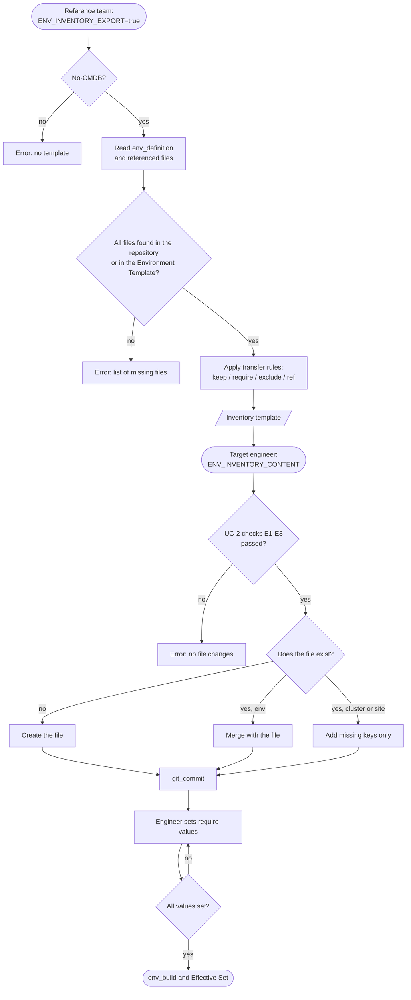

# Inventory template and environment generation

> [!NOTE]
> Design draft (HLD). The step names and parameter names marked "working name" are not final.

## Purpose and scope

The solution adds two components to the EnvGene Instance pipeline:

- Inventory Template Generator creates an Inventory template from a reference environment.
- Inventory Generator creates or updates the Inventory of a target environment from the template.

Goal: the target environment repeats the configuration of the reference environment. Values that are specific to the
target environment are set in its repository. They stay unchanged when the template is applied again.

Limits:

- Only No-CMDB environments (v1 and v2) are supported.
- The template has no Jinja parameters.
- Comments from reference files are not copied to the template.
- One run handles one environment.

## Overview



| Component                    | Instance pipeline step                | Status   | Use case | Does                                                                                    | Does not                                                                            |
|------------------------------|---------------------------------------|----------|----------|-----------------------------------------------------------------------------------------|-------------------------------------------------------------------------------------|
| Inventory Template Generator | `env_inventory_export` (working name) | New      | UC-1     | Reads the reference environment, applies the transfer rules, and publishes the template | Does not change the repository or choose the operation on target files              |
| Inventory Generator          | `env_inventory_generation`            | Extended | UC-2     | Creates or updates Inventory files from the template                                    | Does not define transfer rules. Deletes keys and files only on an explicit `delete` |
| Build check                  | `env_build`                           | Extended | UC-4     | Stops the build when `env_definition.yml` contains `envgeneNullValue`                   | -                                                                                   |

## Inventory Template Generator

A new Instance pipeline step. It does not change the reference repository. The step name and the parameter name are
working names.

| Parameter                             | Type                     | Required | Validation                                                                              |
|---------------------------------------|--------------------------|----------|-----------------------------------------------------------------------------------------|
| `ENV_NAMES`                           | string                   | Yes      | Exactly one `<cluster>/<env>`                                                           |
| `ENV_INVENTORY_EXPORT` (working name) | boolean, default `false` | Yes      | Cannot be used with `ENV_BUILDER`, `GENERATE_EFFECTIVE_SET`, or `ENV_INVENTORY_CONTENT` |

### UC-1. Create an Inventory template

```text
Actor:          reference environment team
Trigger:        Instance pipeline run in the reference repository with ENV_INVENTORY_EXPORT=true
Preconditions:
  - environments/<cluster>/<env>/Inventory/env_definition.yml exists.
  - The environment is No-CMDB (inventory.deployer is not set).
Main flow:
  1. The step reads env_definition.yml and collects file names from envTemplate:
     envSpecific*Paramsets, sharedMasterCredentialFiles, sharedTemplateVariables,
     envSpecificResourceProfiles. It removes duplicates.
  2. The step finds each file:
     - In the instance repository (env, then cluster, then site): the step copies the file
       to the template and writes the level where it found the file to "place".
     - In the Environment Template (paramsets only): env_definition holds only a reference,
       and the file is in the Environment Template artifact. The step does not copy the
       file and keeps the reference. The target environment gets the file from the same
       Environment Template.
  3. The step picks a transfer rule for each value. For env_definition objects, the rule
     comes from the object table. For files, it comes from the file name
     (see "Transfer rules").
  4. The step writes values to the template by rule:
     - keep and ref: the reference value;
     - require: envgeneNullValue and a description;
     - exclude: no key.
  5. The step sets "action: apply" in each template entry.
  6. The step returns the template as the run result.
Alternative flow:
  A1. A require key has no description. The step writes only "Mandatory" above the key.
Exceptions (no template is created):
  E1. inventory.deployer is set.
  E2. A referenced file is not in the instance repository or in the Environment Template.
      The message lists all missing files. EnvGene cannot build such an environment either.
  E3. ENV_NAMES has more than one environment.
  E4. The reference YAML is not valid.
Result:
  An Inventory template. The reference repository does not change.
```

### Transfer rules

The reference environment has three kinds of values:

- Values common to all environments of the model.
- Values specific to each environment.
- Values that only the reference environment needs.

For each value, the step picks a transfer rule. The rule defines what goes to the template and what happens to the value
when the template is applied to a target environment.

| Rule      | What the template gets               | What happens in the target file                                             |
|-----------|--------------------------------------|-----------------------------------------------------------------------------|
| `keep`    | The reference value                  | The template value replaces any other value in the file                     |
| `require` | `envgeneNullValue` and a description | A set value does not change. A missing key is added with `envgeneNullValue` |
| `exclude` | Nothing                              | The key does not change                                                     |
| `ref`     | The list of file names               | Template names are added without duplicates. Other names stay               |

The component defines the rules. `env_definition` objects follow the object table, and files follow the file name. A
rules config is not added until an analysis of real repositories shows that it is needed.

#### env_definition objects

The object list comes from [the env_definition schema](/schemas/env-definition.schema.json).

| Object                                                                  | Rule                     | Reason                                             |
|-------------------------------------------------------------------------|--------------------------|----------------------------------------------------|
| `inventory.environmentName`                                             | `exclude`                | EnvGene takes the name from the environment folder |
| `inventory.tenantName`                                                  | `require`                | Each environment has its own tenant                |
| `inventory.cloudName`, `inventory.cloudPassport`                        | Not decided              | Both fields get the same rule: `keep` or `require` |
| `inventory.clusterUrl`                                                  | `require`                | Each cluster has its own URL                       |
| `inventory.deployer`                                                    | -                        | If set, no template is created (E1)                |
| `inventory.noCmdbVersion`                                               | `keep`                   | See the note below the table                       |
| `inventory.description`, `inventory.owners`                             | `exclude`                | They describe the reference environment            |
| `inventory.config.*`                                                    | `keep`                   | CMDB import flags are the same in one model        |
| `envTemplate.name`                                                      | `keep`                   | One model uses one Environment Template            |
| `envTemplate.artifact`, `envTemplate.templateArtifact.artifact.version` | `require`                | Each environment sets its own version              |
| `envTemplate.templateArtifact` coordinates                              | `keep`                   | The artifact coordinates are the same              |
| `envTemplate.bgNsArtifacts.origin`, `envTemplate.bgNsArtifacts.peer`    | `require`                | Each environment sets its own Blue-Green versions  |
| `envTemplate.additionalTemplateVariables`                               | `require` for each value | The variables have no contract                     |
| Lists of file names in `envTemplate`                                    | `ref`                    | The files follow their own rules                   |
| `metadata`, `security`                                                  | `exclude`                | Not set by hand and not processed by EnvGene       |
| `generatedVersions`                                                     | `exclude`                | EnvGene writes this field during generation        |

Notes:

- `inventory.noCmdbVersion` is optional. If neither this field nor `deployer` is set, the environment is v1 (see
  [deployment architecture](/docs/deployment-architecture.md)). So a reference value of `v2` switches such an
  environment to v2.
- `inventory.cloudName` stays in the template because the Environment Template can require it.
- The `envTemplate.artifact` version can also come from `ENV_TEMPLATE_VERSION`.
- The `envTemplate.templateArtifact` coordinates are `registry`, `repository`, `templateRepository`,
  `artifact.group_id`, and `artifact.artifact_id`. `registry` points to `configuration/registry.yml`, which can differ
  onsite.
- The lists of file names are `envSpecificParamsets`, `envSpecificTechnicalParamsets`, `envSpecificE2EParamsets`,
  `sharedTemplateVariables`, `sharedMasterCredentialFiles`, and `envSpecificResourceProfiles`.

#### Files referenced from env_definition

- A rule applies to a whole file, not to a single parameter.
- A rule per key would need a change for every new parameter.
- A contract name is a file name that is the same in all environments of one model.
- The component defines the rule for each contract name.

| File                             | Rule                         | Reason                                                          |
|----------------------------------|------------------------------|-----------------------------------------------------------------|
| Paramset with a contract name    | The rule for that name       | Defined after a comparison of offsite and onsite environments   |
| Paramset without a contract name | `require` for each parameter | The generator cannot tell which values are common               |
| Shared template variables        | Same as a paramset           | Same format: a set of parameters                                |
| Credentials                      | `require` for each value     | The values are secret. `id`, `type`, and field names are copied |
| Resource profiles                | `keep`, whole file           | Profiles are the same in one model                              |

Keep static common paramsets (for example, e2e) in the Environment Template, and set cluster-specific values with Cloud
Passport macros. Then the Inventory template does not need to copy them.

#### Descriptions

For each `require` key, the template writes a comment above the key: the line `Mandatory` and the key description, if
one exists.

| Keys                                                        | Description source                                                |
|-------------------------------------------------------------|-------------------------------------------------------------------|
| `env_definition` objects                                    | The `description` field in the env_definition schema              |
| Paramset parameters, shared template variables, credentials | Not defined (open question). The template writes only `Mandatory` |

### Result: the template

The template is a document with `kind: InventoryTemplate`. Its `spec` uses the `ENV_INVENTORY_CONTENT` format (see [the
env-inventory-content schema](/schemas/env-inventory-content.schema.json)).

```yaml
apiVersion: v1
kind: InventoryTemplate
metadata:
  name: composite-prod
  source:
    environment: cluster-01/env-01
    commit: 3f2a9c1
  generatedAt: 2026-11-23T10:00:00Z
spec:
  envDefinition:
    action: apply
    content:
      inventory:
        # Mandatory
        # Name of the tenant for your environment
        tenantName: envgeneNullValue
        noCmdbVersion: v2
      envTemplate:
        name: composite-prod
        # Mandatory
        # Artifact details which includes artifact id and version
        artifact: envgeneNullValue
        envSpecificParamsets:
          bss:
            - bss-env-specific
        sharedMasterCredentialFiles:
          - ci-creds
  paramSets:
    - action: apply
      place: env
      name: bss-env-specific
      content: {}
  credentials:
    - action: apply
      place: site
      name: ci-creds
      content: {}
```

| Field                       | Meaning                                                   |
|-----------------------------|-----------------------------------------------------------|
| `apiVersion`                | Template format version                                   |
| `metadata.name`             | Template name                                             |
| `metadata.source`           | The reference environment and commit of the template      |
| `metadata.generatedAt`      | Creation time                                             |
| `spec` entry `name`         | File name, as in the `env_definition` reference           |
| `spec` entry `place`        | File level in the reference: `env`, `cluster`, or `site`  |
| `spec` entry `action`       | Always `apply`. Inventory Generator chooses the operation |
| `spec` entry `content`      | File content after the transfer rules                     |
| `spec` entry `descriptions` | Key path to description, for JSON, which has no comments  |

The template version is a property of the artifact that holds the template, not of the template itself.

How the template is published and delivered is not defined yet.

## Inventory Generator

The existing step `env_inventory_generation`. It creates or updates the Inventory files of the target environment from
the template. For each file, the step chooses the operation: create, merge, or leave unchanged.

| Parameter               | Type          | Required | Purpose                                                    |
|-------------------------|---------------|----------|------------------------------------------------------------|
| `ENV_NAMES`             | string        | Yes      | `<cluster>/<env>` of the target environment                |
| `ENV_INVENTORY_CONTENT` | string (JSON) | Yes      | The template from UC-1                                     |
| `ENV_TEMPLATE_VERSION`  | string        | No       | The Environment Template version of the target environment |

The step supports two actions: `create_or_replace` (creates or overwrites a whole file) and `delete`. This change adds:

- Template input: `ENV_INVENTORY_CONTENT` accepts a document with `kind: InventoryTemplate`, and the old format without
  `apiVersion`, `kind`, and `metadata` works as before;
- The `apply` action: the step chooses the operation on each file (UC-2, step 3).
- Descriptions from the `descriptions` field, written as comments above keys.
- A check of `env_definition` references before any file changes.
- A search for an existing file in the folders of the `place` level.
- `sharedTemplateVariables` written to `configuration/`. The code writes them to `shared_template_variables/`, which is
  not in the EnvGene search paths.

### UC-2. Apply the template to a target environment

```text
Actor:          target environment engineer
Trigger:        Instance pipeline run in the target repository with ENV_INVENTORY_CONTENT
Preconditions:
  - The global repository configuration exists.
  - A Cloud Passport with the contract name exists or is added before the build.
Main flow:
  1. The step runs checks before it changes any file:
     - The template matches the schema.
     - Each file referenced in env_definition is in the template, in the repository,
       or (for paramsets) in the Environment Template.
     - No template file exists in the repository only on another level.
  2. For each entry, the step finds the file in the target repository:
     - envDefinition: environments/<cluster>/<env>/Inventory/env_definition.yml;
     - other entries: the file "name" in the folders of the "place" level.
  3. The step runs the action of the entry:
     apply (created by UC-1):
       - No file: the step creates the file in the recommended folder of the "place" level.
       - The file exists, and the entry is envDefinition or place: env: the step merges
         the file by the rules for environment files.
       - The file exists, and place is cluster or site: the step merges the file by the
         rules for shared files.
     create_or_replace: creates or overwrites the whole file (as before).
     delete: deletes the file. For envDefinition, deletes the environment folder (as before).
  4. The step writes descriptions as comments above new keys.
  5. The git_commit step commits the changes. If nothing changed, there is no commit.
Alternative flows:
  A1. The environment does not exist. The step creates all files.
  A2. The environment exists, including one created by hand. The step merges the files.
  A3. The template did not change, and nobody changed the files since the last run.
      Nothing changes, and there is no commit.
  A4. ENV_NAMES has more than one environment. This is not supported.
Exceptions (step 1, no file changes):
  E1. The template does not match the schema.
  E2. A referenced file is not in the template, the repository, or the Environment Template.
  E3. A file with the same name exists only on another level.
Result:
  The Inventory matches the template. Values and keys set in the environment are kept.
```

The template describes the required state of the Inventory. The step brings each file to that state. The user does not
need to know if the environment exists.

### Merge algorithm

The merge is two-way. The step compares the current target file with the new template. It does not store or read the
previous template. A new template version does not overwrite values set in the environment.

Short rules:

- A change in the reference environment: the environment file takes the change, and a shared file gets only new keys.
- A change in the target environment: `keep` values go back to the reference value, and `require` values and keys added
  by hand stay.
- Shared files (`place: cluster` or `site`): the template only adds missing keys. It does not change existing values or
  delete anything, because all environments of the cluster or repository use these files.

Columns: "Before" is the target environment before the run. "Env file" and "Shared file" are the results after the run
for a file of the environment and for a shared file (cluster, site).

| #  | Case                                     | Template                   | Before                    | Env file                   | Shared file            | Why                              |
|----|------------------------------------------|----------------------------|---------------------------|----------------------------|------------------------|----------------------------------|
|    | **Nothing changed**                      |                            |                           |                            |                        |                                  |
| 1  | Same value                               | `replicas: 2`              | `replicas: 2`             | No change                  | No change              | Nothing to change                |
|    | **Changed in the reference environment** |                            |                           |                            |                        |                                  |
| 2  | A `keep` value changed                   | `replicas: 3`              | `replicas: 2`             | `replicas: 3`, warning     | `replicas: 2`, warning | The reference sets `keep` values |
| 3  | The type of a `keep` value changed       | `limits: 1`                | `limits: {cpu: 1}`        | `limits: 1`, warning       | No change, warning     | The whole value is replaced      |
| 4  | A new `keep` attribute                   | `timeout: 30`              | No key                    | `timeout: 30`              | `timeout: 30`          | The new key is added             |
| 5  | A new `require` attribute                | `dbHost: envgeneNullValue` | No key                    | `envgeneNullValue`         | Not added, warning     | The environment sets the value   |
| 6  | An attribute was deleted                 | No key                     | `legacy: true`            | No change, logged          | No change              | Looks like a key added by hand   |
| 7  | An application was added                 | `app-a`, `app-b`           | `app-a`                   | `app-a`, `app-b`           | `app-a`, `app-b`       | Matched by `appName`             |
| 8  | An application was removed               | `app-a`                    | `app-a`, `app-b`          | No change, logged          | No change              | Same as row 6                    |
| 9  | A paramset reference was added           | `[bss-a, bss-c]`           | `[bss-a, my-local]`       | `[bss-a, my-local, bss-c]` | -                      | Missing names are added          |
| 10 | A paramset was renamed                   | `[bss-a2]`                 | `[bss-a]`                 | `[bss-a, bss-a2]`, logged  | -                      | Same as row 6                    |
|    | **Changed in the target environment**    |                            |                           |                            |                        |                                  |
| 11 | A `keep` value was changed               | `replicas: 2`              | `replicas: 5`             | `replicas: 2`, warning     | `replicas: 5`, warning | Same as row 2 for the step       |
| 12 | A `keep` key was deleted                 | `replicas: 2`              | No key                    | `replicas: 2`              | `replicas: 2`          | Same as row 4 for the step       |
| 13 | A `require` value was set                | `envgeneNullValue`         | `tenant-b`                | No change                  | No change              | The environment owns the value   |
| 14 | A `require` value is not set             | `envgeneNullValue`         | `envgeneNullValue`        | No change                  | No change              | The build fails until it is set  |
| 15 | A key was added by hand                  | No key                     | `custom: x`               | No change, logged          | No change              | Keys added by hand stay          |
|    | **The key rule changed**                 |                            |                           |                            |                        |                                  |
| 16 | `keep` became `require`                  | `envgeneNullValue`         | `tenant-ref`              | No change                  | No change              | Check the key by hand            |
| 17 | `require` became `keep`                  | `version: v2`              | `version: v1`             | `version: v2`, warning     | `version: v1`, warning | Same as row 2 for the step       |
|    | **Key not transferred**                  |                            |                           |                            |                        |                                  |
| 18 | A key with the `exclude` rule            | No key                     | `environmentName: env-02` | No change                  | -                      | The key is not transferred       |
|    | **Run parameter passed**                 |                            |                           |                            |                        |                                  |
| 19 | `ENV_TEMPLATE_VERSION` is passed         | `envgeneNullValue`         | `app:1.0`                 | `app:2.0`                  | -                      | The parameter wins               |
|    | **No file**                              |                            |                           |                            |                        |                                  |
| 20 | No file in the target repository         | File                       | No file                   | File created               | File created           | The file is created              |

Row notes:

- Row 5: the environment file also gets the description above the key.
- Row 6: the environment owner deletes the key by hand.
- Row 9: the order of names in the list is an open question.
- Row 16: the value in "Before" is the old reference value.

#### Limits of the two-way merge

The step compares only the template and the current file. As a result:

- The step cannot tell who changed a value. Rows 2, 11, and 17 look the same to it, and so do rows 4 and 12.
- The step does not handle deletes and renames in the reference environment (rows 6, 8, and 10) or a rule change (row
  16).

The template defines the rule of each key: `envgeneNullValue` means `require`, a list of file names means `ref`, and any
other value means `keep`.

### File placement

The step looks for the file on the `place` level from the template:

- The file exists: the step processes it in place.
- The file does not exist on any level: the step creates it in the recommended folder of the level.
- The file exists only on another level: the step stops with an error, so that two files with the same name do not
  appear.

## Build check

### UC-4. Block the build of an environment with unset values

```text
Actor:     env_build and generate_effective_set steps
Trigger:   environment build (ENV_BUILDER=true, GENERATE_EFFECTIVE_SET=true)
Today:
  generate_effective_set and cmdb_import fail if envgeneNullValue is left in parameters
  or credentials. env_definition fields are not checked, so the environment builds with
  the tenant "envgeneNullValue".
After the change:
  1. env_build checks env_definition.yml for envgeneNullValue.
  2. If it finds such values, the step fails and lists the fields.
  3. The generate_effective_set check of parameters and credentials does not change.
```

## Open questions

- Do the components need a report (found files, `envgeneNullValue` values, values without a description), and must the
  report be saved? Without a report, the same data is in the job log, in `git diff`, and in a search for
  `envgeneNullValue` in the Inventory.
- `cloudPassport` and `cloudName`: `keep` or `require`?
- How must the template handle shared files (cluster, site)? Today the template adds new `keep` keys, does not change
  existing values, does not add `require` keys, and deletes nothing.
- In which order are template paramsets added to the environment list: at the end or at the start? EnvGene applies
  paramsets in order, and the last one overwrites the earlier ones. At the end (today), the template overrides the
  paramsets of the environment. At the start, the paramsets of the environment win.
- Must the template include files from deprecated folders?
- Where do parameter descriptions come from? Options: the JSON schema of the Helm chart for deploy parameters, or
  descriptions from the owners of e2e and technical parameters.
- When an attribute is deleted from the reference environment, must the step delete it from the target environment?
- Must the update logic for existing environments be redesigned? The two-way merge cannot tell reference changes from
  environment changes. So it cannot check deletes, and you cannot choose a merge strategy. A possible option is a
  separate update process: the template as a versioned artifact, a comparison with the version applied before, a change
  plan, and changes applied through a merge request.
- Are template creation and the alignment of the reference environment with best practice one operation or two?
- What happens if the reference and target environments use different No-CMDB versions?
- Must the step stop when a new required parameter belongs in a shared file? Today the step only writes a warning, and
  the environment builds without the parameter.

## Non-functional requirements

| ID    | Attribute                | Condition                                             | Acceptance criterion                                                   |
|-------|--------------------------|-------------------------------------------------------|------------------------------------------------------------------------|
| NFR-1 | Idempotency              | Second run with the same template and unchanged files | `git diff` is empty, and there is no commit                            |
| NFR-2 | Atomicity                | Any check in UC-2 step 1 fails                        | No file changes                                                        |
| NFR-3 | Security                 | Template creation                                     | No credential values in the template or the log. No SOPS key is needed |
| NFR-4 | Data safety              | The template is applied to an existing environment    | No set `require` value and no key added by hand is lost or deleted     |
| NFR-5 | Backward compatibility   | Existing `ENV_INVENTORY_CONTENT` calls                | `env_inventory_generation` regression tests pass                       |
| NFR-6 | GitLab and GitHub parity | Runs in both CI systems                               | Same result. `ENV_INVENTORY_CONTENT` fits the GitHub input limit       |
| NFR-7 | Readable changes         | Commit after Inventory Generator                      | Unchanged keys and comments are not reformatted                        |

