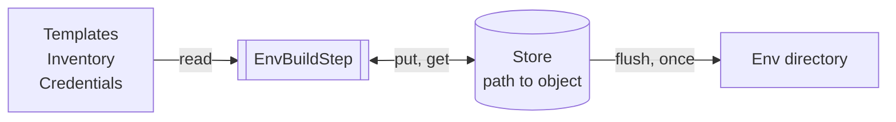

# Current env instance store

- [Problem](#problem)
- [Design](#design)
- [Rules](#rules)
- [What changes for the user](#what-changes-for-the-user)
- [Out of scope](#out-of-scope)
- [Open questions](#open-questions)

## Problem

Env build is slow. It works with files in `tmp/render/<env>`. Each part of the build opens a file, changes
it, and saves it again. So one object is read and written many times.

## Design

The build keeps every object of the env instance in memory, in one store. The store writes the files once,
at the end of the step.

## Rules

- **The store lives only in `EnvBuildStep`.** Other steps do not see it. Only this step writes the env
  instance.
- **Code gets the store with `current_env_instance_store()`.** No parameter is needed. Outside the step
  this call fails.
- **The store never reads the disk.** It gives back only what was put into it. The build reads an input
  file itself and puts the object into the store.
- **The disk is the previous run. The store is the current run.** `get_namespaces(env_dir)` and
  `get_bgd_object(env_dir)` read the disk. `namespaces()` and `bg_domain()` of the store read the current
  run.
- **The store writes once, at the end of the step.** `flush()` sorts each object by schema, adds quotes and
  the header, fixes the space before comments, and writes the file.
- **The store never writes into `Inventory`.** Files there are input, for example an env-specific Resource
  Profile.
- **A failed build writes nothing.** The build removes the generated objects of the env directory at its
  start. After a failed build the env directory has no generated objects, and the job artifact has no
  objects of the failed build.
- **Early steps do not use the store.** `AppregdefRenderStep`, `RegdefV2AdapterStep`, and the Namespace map
  step render an object, take the value they need, and drop the object. They write no drafts into the env
  directory.
- **`env_definition` is not in the store.** The build reads it once and passes it as a parameter. It is
  input and the build does not write it.
- **The build has one directory.** It reads input from the env directory and writes the result there.
  `tmp/render` and `tmp/resource_profiles` are gone.
- **`flush()` does not check by schema.** It only sorts. Each check is a separate call in the build code.

## What changes for the user

One-time changes in the files of the Instance Repository:

- One space before a comment at the end of a line. Some lines had two.
- `cleaned` is the last field of a Namespace.
- `profile.name` stands where the schema puts it.
- New Credentials have no `# FillMe` comment.

Changes in behavior:

- Only the ParameterSets that the environment uses are checked and rendered. A broken ParameterSet that
  nobody uses does not fail the build.
- `validate_bgd` checks the BG Domain and the Namespaces of the current run. Before, it read an empty
  directory and always passed.
- Definition overrides in `configuration/appdefs` and `configuration/regdefs` are checked by schema.
- A schema error is a `ValueError`. The log lists what is wrong.

## Out of scope

- One store for the whole pipeline.
- Reuse of the early renders in `EnvBuildStep`. Cloud is rendered twice per run. BG Domain and Namespace
  are rendered two or three times.
- AppDefs, RegDefs, and ParameterSets in the store.
- Faster sorting by schema.
- Sorting of BG Domain and Composite Structure by schema.

## Open questions

- Memory is measured only on test data. There it did not grow. It is not measured on a large environment
  or on a run with several `ENV_NAMES` values.
